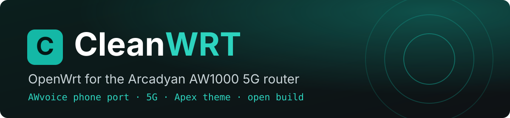
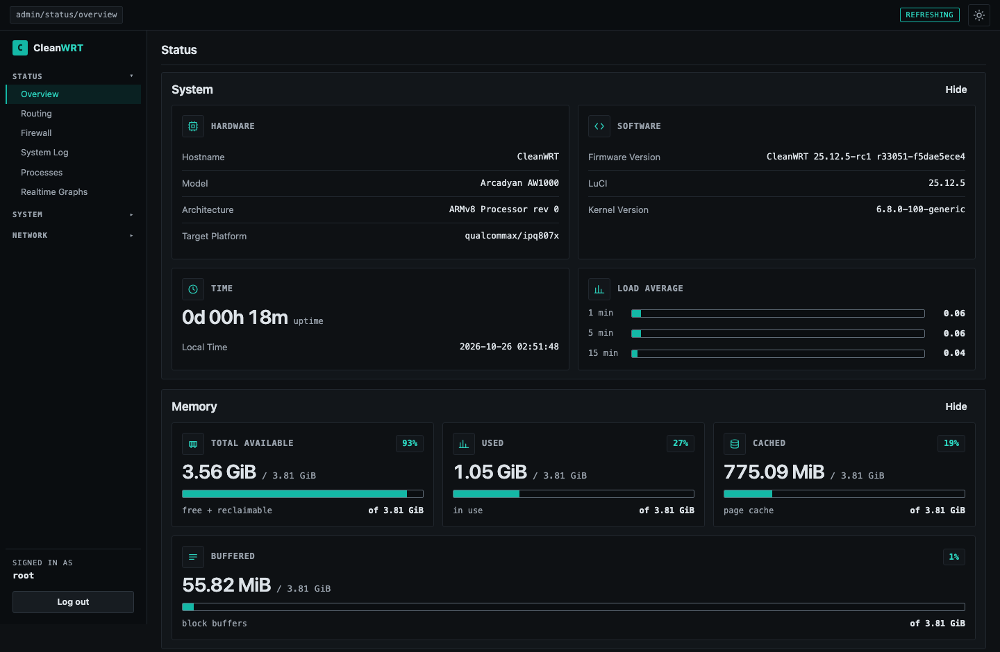
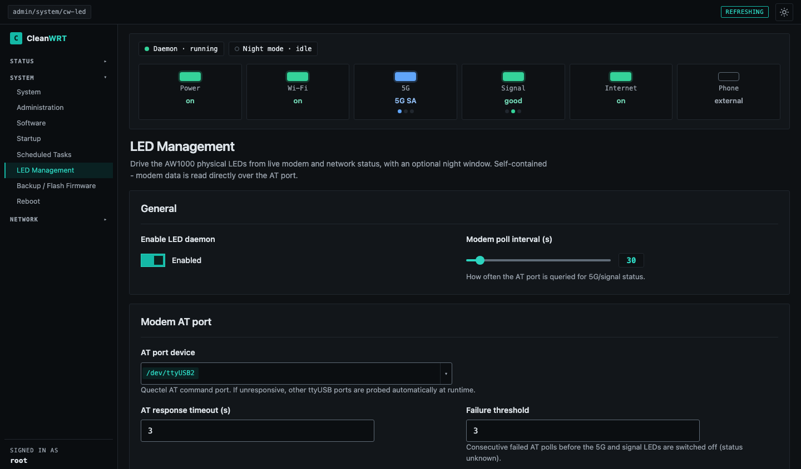
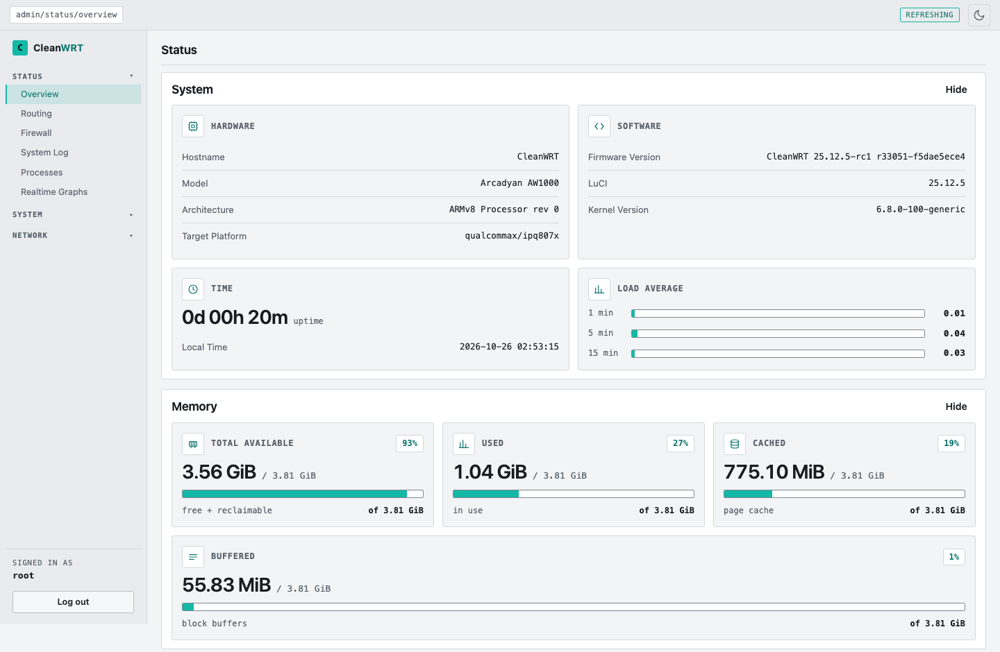
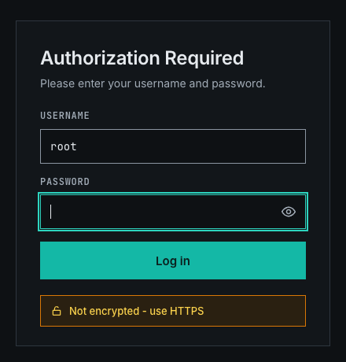
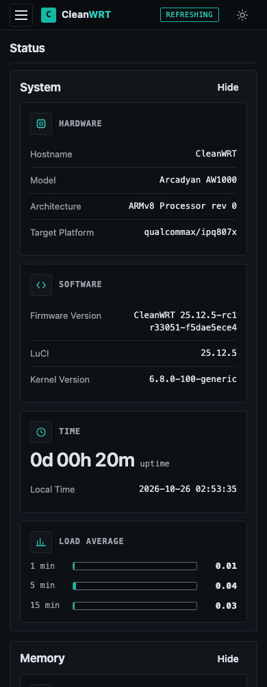

<p align="center">
  
</p>

<p align="center">
  <a href="https://pr0luci.github.io/cleanwrt-aw1000/docs/"></a>
  <a href="https://github.com/Pr0Luci/cleanwrt-aw1000/releases"></a>
  <a href="LICENSE"></a>
  <a href="https://github.com/Pr0Luci/cleanwrt-aw1000/actions/workflows/check.yml"></a>
</p>

# CleanWRT: OpenWrt for the Arcadyan AW1000

CleanWRT is an independent build of **OpenWrt 25.12.5** for the **Arcadyan AW1000** 5G router
(Qualcomm IPQ8072, Quectel RG500Q-EA modem). It is made for people who want the router to simply
work: a phone on the RJ11 socket, a 5G modem that dials and recovers by itself, a modern interface,
and the usual power tools, all switched off until you ask for them.

The whole image is built in the open on GitHub from pinned sources, and every release comes with
checksums and a provenance bundle.

> CleanWRT is *Powered by OpenWrt* and is not affiliated with or endorsed by the OpenWrt project.
> OpenWrt® is a registered trademark of Software Freedom Conservancy (SFC) - https://openwrt.org

<p align="center">
  <a href="docs/assets/img/overview-dark.png"></a>
</p>

## Highlights

| | |
|---|---|
| **AWvoice, a phone on the router** | Plug an ordinary desk phone into the RJ11 socket and make and take calls over your SIM. Caller id, call waiting, hold, a three-way join, recall of a held call, a call log, call recordings, an answering machine, speed dial, call blocking and alarm calls. No extra box, no PBX, no SIP account. |
| **5G that just works** | QModem, auto-dial and auto-recovery, dual-stack IPv4/IPv6, SMS, TTL control, per-interface data usage, and a registration fix for data-only SIMs. |
| **Apex, a modern interface** | Dark and light mode, a sidebar and a phone-friendly drawer, and card-style status widgets for system, modem, memory and storage. |
| **LEDs that mean something** | The 5G LED shows SA or NSA, the signal LED shows quality, the internet LED runs a real connectivity check, and night mode switches them off at bedtime. |
| **Tools, but off by default** | Passwall, Passwall 2, HomeProxy, WireGuard, OpenVPN, Tailscale, Cloudflare Tunnel, Adblock, AdGuard Home, Syncthing, qBittorrent, DLNA, file sharing and a printer server. Nothing listens until you tick **Enable**. |
| **Careful defaults** | HTTPS for the admin UI, no hidden remote access, BBR congestion control, pinned LuCI so an `apk upgrade` cannot undo the build. |
| **Verifiable builds** | Built on GitHub Actions in a pinned Docker environment from commits you can read, with checksums and a provenance bundle for each release. |

## Screenshots

<table>
  <tr>
    <td align="center" width="50%"><a href="docs/assets/img/leds-dark-status.png"></a><br><sub>LED Management: live state of the panel LEDs</sub></td>
    <td align="center" width="50%"><a href="docs/assets/img/overview-light.png"></a><br><sub>Light mode follows your system, or the toggle</sub></td>
  </tr>
  <tr>
    <td align="center"><a href="docs/assets/img/login-dark.png"></a><br><sub>The login page</sub></td>
    <td align="center"><a href="docs/assets/img/overview-mobile.png"></a><br><sub>Made to be used from a phone</sub></td>
  </tr>
</table>

<sub>The screenshots come from a development preview of the interface with a simulated modem. Values such as the kernel, memory and storage differ on a real router.</sub>

## Before you flash

> [!CAUTION]
> **Supported hardware: the Arcadyan AW1000 only, with the expanded flash layout.** The image does
> not fit the stock layout, and flashing it there can leave the router unbootable. Check first:
>
> ```sh
> cat /proc/mtd
> ```
>
> The `rootfs` partition must be **at least `0x08000000`** (128 MiB). If it shows up as `rootfs_bak`
> instead, stop. Read the [MTD layout page](https://pr0luci.github.io/cleanwrt-aw1000/docs/mtd-layout/).

> [!IMPORTANT]
> The very first install from the stock firmware needs a **serial console (UART)** and a TFTP
> server. Read [Installation](https://pr0luci.github.io/cleanwrt-aw1000/docs/installation/) and
> [Recovery](https://pr0luci.github.io/cleanwrt-aw1000/docs/recovery/) before you start.

## Quick install

If the router already runs OpenWrt, and `cat /proc/mtd` is fine:

1. Download the `*-squashfs-sysupgrade.bin` from the
   [Releases page](https://github.com/Pr0Luci/cleanwrt-aw1000/releases) and check it:

   ```sh
   sha256sum -c sha256sums.cw --ignore-missing
   ```

2. Copy it to the router:

   ```sh
   scp cleanwrt-*-sysupgrade.bin root@192.168.1.1:/tmp/
   ```

3. Flash it. Use `-n` (a clean install) when you come from another firmware, because the theme and
   some settings change names:

   ```sh
   ssh root@192.168.1.1 "sysupgrade -n -v /tmp/cleanwrt-*-sysupgrade.bin"
   ```

## First boot

| | |
|---|---|
| Address | `http://192.168.1.1` (over Ethernet) |
| Root password | none: LuCI asks you to set one |
| Wi-Fi | `CleanWRT-5G`, `CleanWRT-2.4G`, WPA2-PSK, default key `CleanWRT#40` |
| Hostname, time zone | `CleanWRT`, UTC |

> [!WARNING]
> Change the root password and the Wi-Fi key on the first login.

## Documentation

Everything is on the documentation site: **https://pr0luci.github.io/cleanwrt-aw1000/docs/**

| Page | What is in it |
|---|---|
| [Installation](https://pr0luci.github.io/cleanwrt-aw1000/docs/installation/) | UART + TFTP for the first install, `sysupgrade` afterwards |
| [MTD layout](https://pr0luci.github.io/cleanwrt-aw1000/docs/mtd-layout/) | what must fit, and how to check your router |
| [Recovery](https://pr0luci.github.io/cleanwrt-aw1000/docs/recovery/) | failsafe, bootloader recovery, the way back |
| [AWvoice](https://pr0luci.github.io/cleanwrt-aw1000/docs/awvoice/) | the phone port, flash codes, safety |
| [The 5G modem](https://pr0luci.github.io/cleanwrt-aw1000/docs/modem/) | QModem, signal, SMS, TTL, modem firmware |
| [Front-panel LEDs](https://pr0luci.github.io/cleanwrt-aw1000/docs/leds/) | what every LED shows, night mode, settings |
| [What is included](https://pr0luci.github.io/cleanwrt-aw1000/docs/included/) | every app, where to find it, its default state |
| [Build from source](https://pr0luci.github.io/cleanwrt-aw1000/docs/building/) | GitHub Actions, Docker, pins, signing |
| [FAQ](https://pr0luci.github.io/cleanwrt-aw1000/docs/faq/) | known limits and common questions |

## How it is built

The repository holds only build configuration, patches and the rootfs overlay. The build runs on
GitHub Actions inside a pinned Docker image, applies the overlay and the patches to a clean OpenWrt
`v25.12.5` tree, and **fails** rather than ship something stale: every feed and every package is
pinned to a commit, a patch that no longer applies stops the build, and the image must fit the
flash layout.

```sh
git clone --depth 1 --branch v25.12.5 https://github.com/openwrt/openwrt.git openwrt
docker build -t cleanwrt-builder docker/
docker run --rm -v "$PWD/openwrt":/build -v "$PWD":/cleanwrt \
  cleanwrt-builder /cleanwrt/tools/cw-release-build.sh /build --clean
```

`CW_CHECK_ONLY=1` runs every check and stops before compiling. See the
[build page](https://pr0luci.github.io/cleanwrt-aw1000/docs/building/) for signing and the optional
package feed.

## The parts

| Repository | What it is |
|---|---|
| [cleanwrt-aw1000](https://github.com/Pr0Luci/cleanwrt-aw1000) | this repository: configuration, patches, overlay, workflows, documentation |
| [AWvoice](https://github.com/Pr0Luci/openwrt-aw1000-voice-awvoice) | the phone port: kernel module, daemon and LuCI page |
| [luci-app-cw-led](https://github.com/Pr0Luci/luci-app-cw-led) | the front-panel LED daemon and its page |
| [luci-theme-apex](https://github.com/Pr0Luci/luci-theme-apex) | the Apex theme |

## Help and contributions

- A bug or a question: open an [issue](https://github.com/Pr0Luci/cleanwrt-aw1000/issues) and fill in
  the form. Please never paste passwords, keys or full IMEI/IMSI numbers.
- A fix or an improvement: open a pull request. `main` is protected, the checks must pass, and
  changes are squash-merged. See [Contributing](https://pr0luci.github.io/cleanwrt-aw1000/docs/contributing/).
- A mistake in the docs: every page has an *Edit this page* button.

## Thanks

CleanWRT stands on the work of others: the [OpenWrt](https://openwrt.org) project and its
contributors, [QModem](https://github.com/FUjr/QModem),
[Passwall](https://github.com/Openwrt-Passwall) and Passwall 2,
[3ginfo-lite](https://github.com/4IceG/luci-app-3ginfo-lite),
[luci-app-diskman](https://github.com/lisaac/luci-app-diskman), and the ImmortalWrt packages that
carry qBittorrent and AdGuard Home to LuCI. Each keeps its own licence, see
[NOTICE.md](NOTICE.md).

## Licence

GPL-2.0-only, see [LICENSE](LICENSE). It covers the build configuration, patches and rootfs overlay
scripts of this repository. The OpenWrt base and each bundled package keep their own upstream
licences.

> [!NOTE]
> **QModem** carries an added non-commercial clause. CleanWRT is free of charge and is not sold,
> but if you deploy it in a business, for an ISP or in a paid service, read QModem's licence first.
> See [Licence and notices](https://pr0luci.github.io/cleanwrt-aw1000/docs/licence/).
