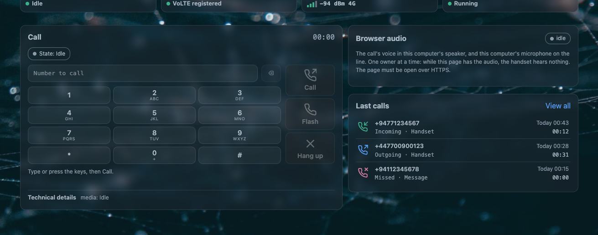

# AWvoice: a phone line on the router

**AWvoice** turns the AW1000's RJ11 socket into a working telephone line. The call is carried by
the router's 5G modem over VoLTE, so your SIM's number is the line's number: no PBX, no Asterisk,
no SIP provider, no second number.

Three things can hold that line, and none of them needs the others:

| | what it is | what it does |
|---|---|---|
| **A handset** | an ordinary analogue phone on the RJ11 socket | lifts, dials, rings, shows caller id on its own display |
| **The web page** | the router's own LuCI page | a keypad, a call rail, a microphone and a speaker: the browser *is* the phone |
| **A network phone** | a soft phone on your own LAN | registers to the router and rings and dials through the same SIM line |

The socket can be empty. With nothing plugged into it, the web page and a soft phone both make and
take calls, which is what makes the router usable as a phone without buying a handset for it.

!!! danger "Read this before you connect anything"
    - About **46 V DC** sits on the RJ11 contacts, and up to about **100 V while a call rings**.
      Do not touch the contacts, and do not wire the socket into anything but a telephone.
    - **This is not equipment for emergency calls.** The line exists only while the router has
      power, the modem is registered for VoLTE and your operator carries the call. There is no
      certification and no battery backup. Keep a phone that works independently for emergencies.
    - Nothing on this router blocks an emergency number, and a dialled emergency number is never
      replaced by a speed-dial entry. That is a property of the design, not a guarantee of service.

## What it does

| calls | |
|---|---|
| Dial tone, ring, answer, hang up, clear speech both ways | [the handset](awvoice/handset.md), [the web page](awvoice/web-phone.md) |
| All of it with nothing in the RJ11 socket | [the web page](awvoice/web-phone.md) |
| Hook flash, call waiting, hold, swap, three-way join | [the handset](awvoice/handset.md) |
| Held-call recall: put the handset down, the phone rings it back | [the handset](awvoice/handset.md#recall) |
| Caller id on the handset's display — FSK (Bellcore or ETSI) or DTMF, before or after the first ring | [the handset](awvoice/handset.md#caller-id) |
| Calling-line restriction, network service codes, hotline | [the handset](awvoice/handset.md#the-numbers-you-do-not-show) |
| Progress tones, or the network's own ringback | [the handset](awvoice/handset.md#tones) |
| HD voice at 16 kHz, following what the modem reports | [how it works](awvoice/how-it-works.md#hd-voice-is-a-wish-and-the-modem-decides) |
| Emergency numbers | never blocked by anything here |

| around the call | |
|---|---|
| Call log with search, filters and CSV export | [calls](awvoice/calls.md) |
| Call recordings: stereo, the caller and the handset on separate channels, opt-in | [recordings and the machine](awvoice/recordings-and-machine.md#call-recordings) |
| Answering machine: your greeting, then a message, linked from the call's own card | [recordings and the machine](awvoice/recordings-and-machine.md#the-answering-machine) |
| Quiet hours: windows when the phone must not ring, and who rings through them | [quiet hours](awvoice/quiet-hours.md) |
| Phone book with speed dial, and contacts that ring through quiet hours | [rules and the phone book](awvoice/rules-and-phonebook.md) |
| Call blocking by direction, number or prefix | [rules and the phone book](awvoice/rules-and-phonebook.md#call-blocking) |
| Alarm calls that dial or ring at a time you set | [rules and the phone book](awvoice/rules-and-phonebook.md#alarm-calls) |
| The front-panel phone LED: solid, fast blink, slow blink | [the handset](awvoice/handset.md#the-phone-led) |

| the network side, off until you turn it on | |
|---|---|
| A soft phone on your own LAN, beside the handset | [network phones](awvoice/network-phones.md) |
| A code a phone scans to set itself up | [network phones](awvoice/network-phones.md#the-code-a-phone-scans) |
| The browser as a telephone, over an encrypted LAN stream | [the web page](awvoice/web-phone.md) |

## What is on when the router boots

| | |
|---|---|
| The phone line | **on**. `awvoice.main.enabled` ships as `1`, so the service starts at boot and the line is ready |
| The web page | available as soon as LuCI is; it needs no separate switch |
| The browser's microphone and speaker | off until you press the page's audio button, once per browser |
| The network phone side | **off**. Nothing speaks SIP and no SIP port is open until you switch it on |
| Call recordings | **off** |
| The answering machine | **off**, although a greeting ships with the package so it works the moment you switch it on |
| Quiet hours | off until you write a window; with no window the phone rings at every hour |

## Start here

The packages are already in CleanWRT, so there is nothing to install. Plug an ordinary analogue
phone with an RJ11 plug into the socket, and lift the handset: you should hear a dial tone.

If the line was switched off at some point, switch it back on:

```sh
uci set awvoice.main.enabled=1
uci commit awvoice
/etc/init.d/awvoice restart
```

Then, in any order you like:

1. Open **Services → AWvoice(RJ11)** and read the [page tour](awvoice/the-page-tour.md) beside the
   real thing.
2. Make a call from the page's keypad with the [handset unplugged](awvoice/web-phone.md), to see
   that the line does not depend on the socket.
3. Decide what should happen to a call you do not answer:
   [the answering machine](awvoice/recordings-and-machine.md#the-answering-machine) or
   [quiet hours](awvoice/quiet-hours.md). Joining two calls into one conversation is a separate
   switch, and it is **off** as installed.
4. If a soft phone on your own network should ring too, turn on the
   [SIP side](awvoice/network-phones.md) — and read what it opens before you do.

What you need for the line itself: a SIM and an operator that provide **VoLTE**, and the modem in
**PCM slave mode**. AWvoice reads both, reports them on the [Health tab](awvoice/health-and-tests.md),
and never changes the modem's audio mode by itself. The line chip's board file ships with the
package and is installed on the first start, so there is nothing to prepare.

## The page

One LuCI page at **Services → AWvoice(RJ11)**, seven tabs. It reads the daemon over `ubus` and
writes the same `/etc/config/awvoice` file the shell does, so the page and `uci` never disagree.

[](assets/img/awvoice/overview-web-phone.png)

| tab | what lives there | the page that explains it |
|---|---|---|
| **Overview** | the line's state, the current call, and the browser phone with its keypad and call rail | [the web page](awvoice/web-phone.md) |
| **Calls** | the call log, and each call's own recording or message | [calls](awvoice/calls.md) |
| **Rules** | four panes: the phone book, call blocking, alarm calls, quiet hours | [quiet hours](awvoice/quiet-hours.md), [rules](awvoice/rules-and-phonebook.md) |
| **Phone settings** | the line's behaviour, the tones, the levels, the recording and answering-machine cards | [the handset](awvoice/handset.md), [recordings and the machine](awvoice/recordings-and-machine.md) |
| **SIP** | whether a phone on your own network may join the line, and the account it signs in with | [network phones](awvoice/network-phones.md) |
| **Health** | what the hardware actually reported: rates, guards, storage, the last call's outcome | [health and tests](awvoice/health-and-tests.md) |
| **Test tools** | the ring test, the line test, and the loopback call test, which this build does not offer yet | [health and tests](awvoice/health-and-tests.md#the-tests) |

Every control's label, what it writes and when it is disabled is listed in
[the page tour](awvoice/the-page-tour.md).

## How it works

Three packages, and the line logic in one daemon:

| package | what it is |
|---|---|
| `kmod-awvoice-fxs` | the kernel module: the line chip's register bus, the PCM block, the audio bridge between the modem and the chip, the capture tap that feeds the recordings, the playback ring that carries a greeting and the page's voice to the caller, and the hardware ring watchdog. GPL-2.0-only |
| `awvoice-phoned` | the phone daemon: the hook, the tones, dialling, ringing, caller id, the call log, the recordings, the machine, quiet hours, the page's audio stream, the front end a network phone speaks through, and the `ubus` service `awvoice` |
| `luci-app-awvoice` | the LuCI page |

The short version of the design: a **watchdog**, not a promise — if the phone service ever stops,
the kernel puts the chip back into reset within milliseconds, so the line cannot be left ringing.
Everything else follows from a **20 ms frame** that is the unit everywhere, from the kernel bridge
to the browser stream to the recording file.

The long version, including the front-end socket, the HD-voice negotiation and the board file, is
in [how it works](awvoice/how-it-works.md).

## If something is wrong

Start with [troubleshooting](awvoice/troubleshooting.md): no dial tone, one-way audio, no caller
id, a machine that will not answer, a soft phone that registers but never rings, a browser page
with no sound. Each symptom has one check that decides it.

## Reference

| | |
|---|---|
| Every option, its values and its shipped default | [settings reference](awvoice/settings-reference.md), and the whole image's options in [UCI options](reference/options.md) |
| Every file, port, socket and `ubus` method | [files and ports](reference/files-and-ports.md), [the API and who may call it](reference/ubus-and-acl.md) |
| What was measured on a real router | [health and tests](awvoice/health-and-tests.md#what-has-been-measured-on-a-router) |
| What changed in each release | [changelog](changelog.md) |
| The source, its licence and the packages | [repositories](repositories.md), [licence](licence.md) |

!!! info "About the screenshots"
    These were taken from a real AW1000 running this firmware. The numbers in them — uptime,
    signal, call times, the caller ids in the log — belong to the moment they were taken and will
    differ on your router.
