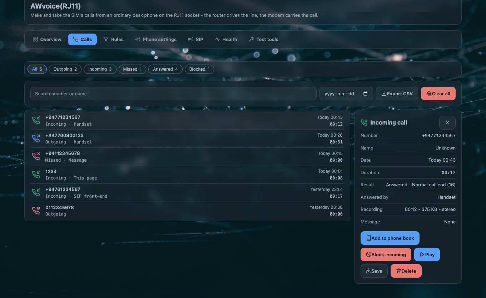

# Calls

The **Calls** tab is the line's memory: every call the router handled, in one list, newest first,
with whatever that call left behind attached to it.

## What one call record holds

| field | what it says |
|---|---|
| **type** | `IN` an incoming call, `OUT` one you placed, `MISS` a call that rang and was not taken |
| **number** | the digits the network sent, shown in the form your numbering plan says. A contact's name from the [phone book](rules-and-phonebook.md) replaces it when the digits match |
| **time** | when the call was decided, from the router's clock |
| **duration** | seconds of connected call. A missed call has none |
| **outcome** | one word: see below |
| **cause** | the reason behind the outcome when there is one to give |
| **answered by** | only when someone took it: `handset`, `machine`, `web` or `sip` |
| **recording** | the file this call was recorded to, when recording was on |
| **message** | the answering-machine message this call left, when it did |

| outcome | what happened |
|---|---|
| `answered` | the call was taken and connected |
| `missed` | it rang and nobody answered. The network ended it |
| `no_answer` | the call was never answered from this side, recorded separately from a plain miss |
| `rejected` | you refused it — the handset's code, the page's **Reject**, or a quiet-hours window set to release callers |
| `blocked` | a [rule](rules-and-phonebook.md#call-blocking) stopped it before it rang |
| `busy` | the line was engaged |
| `failed` | the attempt did not get through: no service, the modem refused the dial, or the network released it |

!!! note "What the log never holds"
    A **name is not stored**, only the digits and, at display time, the phone-book entry they match.
    A **recording or message file name never contains a phone number** — a file is named for the
    call's time and its id, so a leaked file is not a leaked contact list. The service log
    (`logread`) carries no numbers either; the display form of a number is a property of the page.

## Reading the list

The tab carries the line's state at the top and the list below it.

| control | what it does |
|---|---|
| the search box | matches digits or a contact name as you type |
| the filter chips | `All`, `Outgoing`, `Incoming`, `Missed`, `Answered`, `Blocked`. The last two are views on the outcome, not kinds of call, and each chip carries its count |
| **From date** | limits the list to calls from that date on |
| **Export CSV** | the list as it currently stands, filters included: `Type, Number, Name, Date, Duration (s), Result, Answered by, Network cause` |
| **Clear all** | empties the log. It is disabled while a *result* filter is showing, because the daemon deletes by call type |
| a call's own card | opens under the row: the fields above, and the audio controls for whatever this call left behind |

A card's audio controls are **play**, **save** and **delete**, and they appear only when that call
actually has something to play — a call with no recording and no message shows nothing extra. The
card also offers **Add to phone book**, and **Block incoming** / **Block outgoing** for that
number, which are absent when the caller withheld their number.

## Where the log lives

Two copies, deliberately:

| path | what it is |
|---|---|
| `/var/run/awvoice-phoned/calls.json` | the working copy, in memory-backed storage, so a call that ends does not write to flash |
| `/etc/awvoice/calls.json` | the copy on flash, which is what survives a reboot |

The daemon flushes its in-memory log when it stops, so the two agree after a clean restart. If the
flash copy is ever unreadable — a cut write, a hand edit with a stray character — the daemon renames
it to `calls.json.bad` rather than overwrite it, and starts a fresh log. Your old records are still
in that file.

Both copies are kept across a `sysupgrade`, because the package ships a keep-list entry for
`/etc/awvoice/`. See [files and ports](../reference/files-and-ports.md#the-phone-ports-data).

Two limits worth knowing: the log holds the most recent **200** calls and drops the 201st, and the
memory copy is written down to flash at most **every ten minutes**, so a power cut can lose the last
few minutes of records. The flash copy is written as a temporary file and renamed, mode `0600`, so
it is never half-written.

## The outcome words in real life

| you want to know | read |
|---|---|
| who rang while you were out | type `MISS`, and the time |
| whether the answering machine took a call | **answered by** `machine`, and the message attached to that row |
| whether the browser page answered | **answered by** `web` |
| whether a soft phone answered | **answered by** `sip` |
| why a call you placed failed | outcome `failed` and the cause |
| whether a rule stopped a caller | outcome `blocked` — the rule that matched is on the [Rules tab](rules-and-phonebook.md#call-blocking) |
| whether quiet hours held a call quiet | outcome plus the cause word, and the [Health tab](health-and-tests.md) says what decided the last call |

## Settings on this page

The log itself has no options. What changes what appears in it:

| option | default | effect on the log |
|---|---|---|
| `record_enabled` | `0` | with it on, each answered call carries a recording |
| `machine_enabled` | `0` | with it on, unanswered calls carry a message and are marked answered by the machine |
| `region` | `auto` | the form a number is displayed in. The stored digits do not change |
| phone-book entries | none | a matching number is shown as its contact name |

## When the list looks wrong

| symptom | what it means |
|---|---|
| The list is empty after calls were made | the page reads the daemon, so an empty list with a running daemon means the flash copy was unreadable and a new log started. Look for `/etc/awvoice/calls.json.bad` |
| Calls are there but no recordings | recording is off by default. It records what it hears from the moment it is switched on, not the calls before |
| A recording is missing from an old call | recordings are attached after the fact: the log line and the file are separate, and a file deleted by the size budget leaves the call without one |
| Names show as numbers | the phone-book entry does not match the digits the network sent. The [rules page](rules-and-phonebook.md#matching-a-caller) explains how a number is matched |
| Times are wrong | the router's clock. Set your time zone; the log stores the moment, the page shows it in the browser's zone |

## Questions people ask

??? question "Does CleanWRT keep a record of every call?"
    Yes, in the call log: type, number, time, duration and outcome for every call the router
    handled. It is stored on the router under `/etc/awvoice/` and survives an upgrade that keeps
    settings. Nothing is sent anywhere.

??? question "Are call recordings kept on the router or somewhere else?"
    On the router only, as WAV files in `/etc/awvoice/recordings/`. There is no upload, no remote
    storage and no network share involved. Play, save or delete them from the call's own card.

??? question "Can I export the call log?"
    The Calls tab exports what it is currently showing as CSV, filters included.

??? question "Does the log show who answered — the handset or the page?"
    Yes. A call someone took carries **answered by**: `handset`, `machine`, `web` or `sip`.
