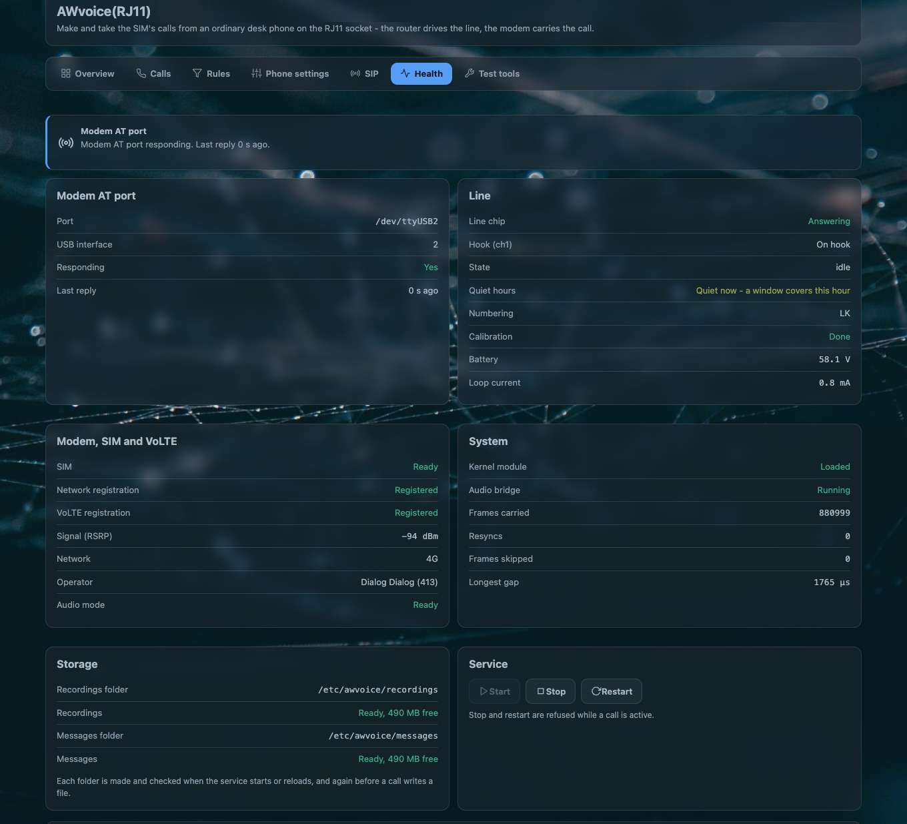

# Health, tests and the log

The Health tab reports **facts, not an opinion**. Where two things could disagree — the rate you
asked for and the rate the modem actually puts on the bus — both are shown separately, so a mismatch
is visible instead of inferred.

[](../assets/img/awvoice/health-tools.png)

## Modem AT port

| field | what it answers |
|---|---|
| **Port** | the tty the daemon found for the modem's USB interface |
| **USB interface** | `at_interface`, as configured |
| **Responding** | did the last question get an answer |
| **Last reply** | seconds since one did |
| **Port owner** | `free`, or the guard's word for what is holding it |

## Line

| field | what it answers |
|---|---|
| **Line chip** | *Answering* or *Not answering* — is the chip replying on the register bus |
| **Hook** | the hook state the chip reports, per channel |
| **State** | the line's state as the daemon sees it |
| **Quiet hours** | whether the line is quiet now, and what decided it: `window`, `all-day` or `manual` |
| **Numbering** | the numbering plan in force, and whether it came from the network or from your setting |
| **Calibration** | whether the chip calibrated at start |
| **Battery** | the DC voltage on the pair, in volts |
| **Loop current** | what flows through a connected handset, in milliamps |

`Battery` and `Loop current` are the two that tell you whether an unresponsive phone is the phone's
fault or the line's.

## Modem, SIM and VoLTE

| field | what it answers |
|---|---|
| **SIM** | is the card ready |
| **Network registration** | is the modem registered for service |
| **VoLTE registration** | is it registered in the IMS — the one that makes voice possible |
| **Signal (RSRP)** | the serving cell's RSRP in dBm |
| **Network / Operator** | the RAT and the operator name the network reported |
| **Audio mode** | three separate facts: `hdVoice` as `on`, `set` or `off` (the wish, and whether it was honoured), `audioRate` (8000 or 16000), `voiceLayout` |
| **Call waiting** | what the network itself says is provisioned, read back rather than assumed |
| **CLIR** | the setting, and the network's provisioning word: `not_provisioned`, `provisioned`, `unknown`, `restricted` or `allowed` |

!!! note "Why the rate is three fields"
    Asking for HD voice is a wish. The modem is asked which rate it actually puts on the bus, the
    line comes up at that rate only if the answers agree, and only while nobody is using the line.
    Seeing the wish, the answer and the layout together is how you tell a refused wish from a broken
    line.

## System

| field | what it answers |
|---|---|
| **Kernel module** | is `awvoice-fxs` loaded |
| **Audio bridge** | is it running |
| **Frames carried** | how many 20 ms frames have crossed it |
| **Resyncs** | how often the two sides lost step and were realigned |
| **Frames skipped** | playback frames the ring was empty for — counted silence, never a stale frame from an earlier call |
| **Longest gap** | the biggest hole seen between slots, in microseconds |

These four counters are the difference between "the audio is odd" and "the bridge is resyncing every
few seconds". They read as empty when the statistics cannot be read at all, which is itself the
answer.

## Storage

Two rows, one for the recordings folder and one for the messages folder: the path, whether it is
ready, how many megabytes are free, and the error if it is not. A drive that is not mounted says so
in words; anything else reports the operating system's reason.

The folders are made and checked when the service starts or reloads, and again before a call writes
a file.

## Service

**Start**, **Stop**, **Restart** — each with a confirmation, and each gated:

| button | disabled when |
|---|---|
| Start | the service is already up |
| Stop, Restart | a call is in progress, or the line is ringing |

Stop and restart are refused while a call is active, from the same check the page uses to grey the
buttons out.

## Counters

| field | what it counts |
|---|---|
| **Modem timeouts** | AT questions that went unanswered |
| **Hook gaps over 20 ms** | how often the 5 ms clock missed a hook sample — the number that explains a choppy hook flash |
| **Longest hook gap (ms)** | the worst one seen |
| **Faults** | the daemon's own fault count |

## SIP and the guards

| field | what it answers |
|---|---|
| **Who holds the name (`qmodem_voip`)** | `awvoice`, `voipd` or `none`. This decides whether a network phone can be offered |
| **Who holds the voice port** | whether another process has the modem's voice AT port |
| **Last refusal** | the fixed word from the last denied action |
| **Browser audio** | the mode, whether a session is live, the port and the address |

## The log

The tab's folded **Recent log** shows the last 40 lines of the service's own log, with every run of
digits masked to `[number]` — so a log can be pasted into a report without carrying a phone number.

Over SSH the same thing, wider:

```sh
logread -e awvoice-phoned | tail -50     # the daemon
logread -e cw-led                        # the LED daemon, if the panel looks wrong
```

## The tests

On **Test tools**, and all three need the line **idle**.

| test | what it proves |
|---|---|
| **Ring test** | the chip can drive the ringer for 5 seconds. Keep the handset on the hook: a phone's ringer can draw more than the chip's AC ring detector tolerates, and when that happens the burst is cut and the log says `the chip's ring trip fired before any lift`. That sentence is a fact about the phone, not a dead line |
| **Line test** | the electrical state: hook, battery voltage, loop current, whether it matches what the board file expects, and whether a leak is suspected |
| **Test call** | loopback, so you hear your own voice after a short delay. **This build does not offer it** — the card is disabled and tagged *Not available yet* |

## What has been measured on a router

These are the checks that were actually run on a real AW1000, and they are the reason the pages say
what they say:

| check | result |
|---|---|
| a call made and taken with the RJ11 socket empty, from the browser page and from a soft phone | both directions worked |
| the handset taking over a call the browser page held | the call continued at the phone, the page's microphone and speaker stopped, and the log named the handset as the one that answered |
| hold, resume, taking a waiting call, swapping two, and the three-way join from the page | worked, with *3-way calling* switched on |
| a wideband call brought up at 16 kHz and recorded | the recording carried both voices at the rate the modem answered |
| a soft phone registering with the vendor VoIP engine on the boot path | registered, no audio — which is what the first-boot script that takes it off the boot path fixes |
| the SIP switch moved while a call was in progress | the switch reported `waiting` and the service moved when the call ended |
| the answering machine answering, and a lift in the middle of a message | the message ended at the lift and the rest of the conversation was not recorded |
| quiet hours in all three modes | silent held the line quiet and the page offered **Answer**; machine mode handed the call to the machine; reject released the caller |

!!! note "What has not been measured"
    The handset's transmit band above 4 kHz has not been confirmed with an instrument, and the
    loopback test call has never been run because the build does not offer it. Where a page claims a
    number, it is one that was read from a device or from the shipped source.

## Questions people ask

??? question "How do I check the AW1000's phone port without a handset?"
    **Health** tells you the chip is answering, the hook state, the battery voltage and the loop
    current without anything on the line. The **Ring test** and **Line test** are on the Test tools
    tab.

??? question "Why does the Health tab show two different audio rates?"
    Because they are two different facts: what you asked for and what the modem answered with. The
    line runs at the modem's answer, and a wish that was not honoured is shown as one.

??? question "Is it safe to send you the log?"
    The page's own log view masks every run of digits. `logread` on the router does not, so read it
    before you paste it, and never include a password or a full IMEI.
