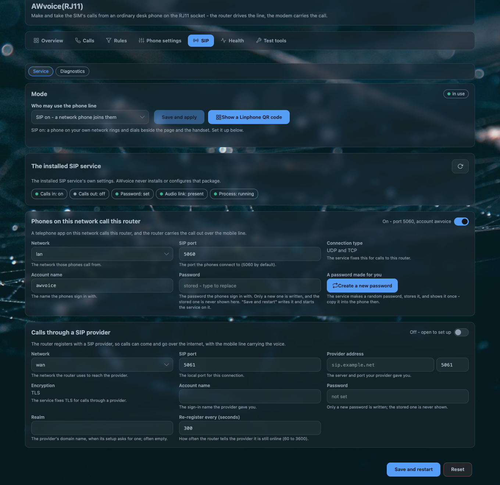
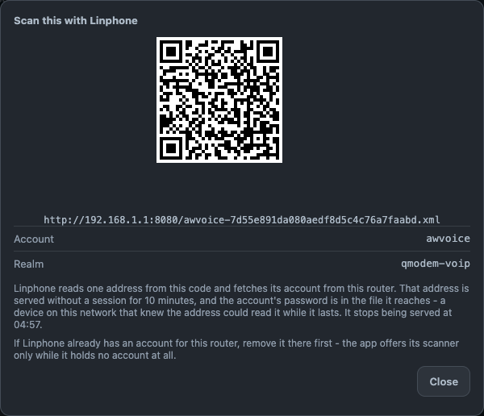

# Network phones

The line has one number and any number of phones on it. This page is about the third of them: a
**soft phone on your own network** — a laptop or a phone running a SIP app — ringing and dialing
through the same SIM line as the handset and the browser page.

!!! important "Nothing speaks SIP until you say so"
    A router as installed has **no SIP port open and no SIP process running**. `awvoice.sip.mode`
    ships as `web`, which means the page and the handset only. Everything on this page happens after
    you move that switch.

## What the switch actually does

The SIP tab's first card asks one question — **who may use the phone line** — and has two answers:

| the card says | the option writes | what happens next |
|---|---|---|
| *SIP off — the page and the handset* | `awvoice.sip.mode = web` | the service is stopped, and the front-end name this port publishes is withdrawn |
| *SIP on — a network phone joins them* | `interop`, or `baresip` if that is the word already stored | the service is started |

Saving is one action with a fixed order, and the card tells you where it got to:

1. the side is written to `/etc/config/awvoice`;
2. the page waits for the daemon to publish or withdraw the front-end object `qmodem_voip` — eight
   tries, 250 ms apart;
3. the service's own init script, `/etc/init.d/qmodem_voip_sipd`, is started or stopped.

While step 3 is pending the card re-checks every two seconds for up to a minute, and after a move it
re-reads every 1.5 seconds up to six times. The outcome word is always shown:

| the card says | what it means |
|---|---|
| `started` / `stopped` | the service moved as asked |
| `waiting` | a call is in progress. The service moves when the call ends rather than being cut in half |
| `absent` | there is no SIP service installed on this router |
| `denied` | this account may not start or stop it — the permission is a separate grant |
| `failed` | the service did not answer. The move is yours to make |

!!! note "A word the build does not know is refused, not ignored"
    `awvoice.sip.mode` accepts `web`, `interop` and `baresip`. Anything else is refused, said so in
    the log, and the line stays on the side it was on.

## What the service is

The network phone is carried by a **separate program on the router** — the SIP service that comes
with the QModem feed. This page's software does not contain any of it, does not reconfigure it, and
does not store its secrets. The relationship is exactly two things:

| | |
|---|---|
| **who may use the line** | decided here, in `awvoice.sip.mode` |
| **how a network phone signs in** | decided there, in `/etc/config/qmodem_sip` |

The AWvoice page reads that file's settings back and shows them, and it is the only place you can
change them without a shell. The values this image ships are in
[UCI options](../reference/options.md#qmodem_sip--the-service-a-network-phone-uses).

### Calls coming in

| setting | default | |
|---|---|---|
| *Allow the calls coming in* | on | the inbound direction |
| *Network* | `lan` | which interface it listens on |
| *SIP port* | `5060` | UDP and TCP together, shown as fixed text |
| *Account name* | `awvoice` | the name a soft phone signs in with. It is named for this router's phone service |
| *Password* | `CleanWRT#40` | the same secret as the default Wi-Fi key, so a router has one pair to remember |

### Calls going out through a provider

| setting | default | |
|---|---|---|
| *Allow the calls going out* | off | the outbound direction |
| *Network* | `wan` | |
| *SIP port* | `5061` | |
| *Provider address* | unset | server and port |
| *Encryption* | TLS | fixed |
| *Account name*, *Realm*, *Password* | unset | **the image ships no outbound secret at all** — the direction that reaches a server outside the house starts empty |
| *Re-register every* | `300` s | |

### Passwords, and what is never shown

The password field shows `stored — type to replace`, or `not set`. A stored password is never
displayed, because it cannot be read back: it is stored in a form that cannot be reversed. Type it
once if you need to see it, or press **Create a new password** to get a fresh one.

The credential the service actually uses lives at `/var/run/qmodem_voip/sip.conf` — a derived file
in memory-backed storage, regenerated from `/etc/config/qmodem_sip` when the service starts and when
its configuration is reloaded. The page reports whether that file is in place. It never reads it.

## The two guards

A second front end on one line can fight the first, so two checks decide whether the network side
may run at all. They are **checks, not negotiation**: this port never opens, closes, stops or
reconfigures another program's things.

| guard | the question | what a bad answer means |
|---|---|---|
| **the voice AT port** | is another process holding the modem's voice AT port? | the phone daemon cannot run the modem, so the network side is not started |
| **the front-end name** | is the object name `qmodem_voip` already registered by something else? | the network side may not offer it. The page and the handset still work — the name decides only the network half |

Both are asked again at service start, on a settings reload, on a modem hotplug, and on the daemon's
slow re-check. The Health and Diagnostics panes report the current answers, so a refusal is a fact
you can read rather than a thing you infer.

!!! tip "The vendor VoIP engine is off the boot path in this image"
    A `qmodem_voip` engine that starts before the phone daemon takes the name, and a soft phone then
    registers but never gets audio. This image stops that engine and removes it from the boot path on
    first boot, precisely so the phone daemon can answer the name itself. See
    [first-boot defaults](../reference/uci-defaults.md).

## What a soft phone needs to be set to

| field | value |
|---|---|
| SIP server / domain | the router's LAN address |
| Port | `5060` UDP (or TCP) |
| User / auth id | the *Account name* on the page (`awvoice` as shipped) |
| Password | the *Password* on the page |
| Display name | anything you like |

A call placed from the soft phone goes out over the SIM; a call to the SIM's number rings the
soft phone as well as the handset. Whoever answers first has the call, and the
[handset-wins-a-lift rule](web-phone.md#who-owns-the-line) is what keeps that from becoming a
contest.

## The code a phone scans

Typing the five fields above into a phone is the last part of the job nobody enjoys. The SIP tab's
**Show a Linphone QR code** button removes it.

| | |
|---|---|
| what the code holds | **one URL and nothing else**, because a provisioning URL is what that app expects to read from a code |
| what the phone does with it | fetches the file at that address and builds the account itself. Nothing is typed |
| where the file is written | `/www/awvoice-provision/awvoice-<32 hex>.xml`, by `/usr/libexec/awvoice-provision`, under a random name |
| how it is served | a plain HTTP listener on port `8080`, with directory listings off and the private-network filter on, whose document root is that one directory |
| how long it lives | **ten minutes**. The card names the minute it stops being served, and the daemon's own round runs every 60 seconds and retires the files this feature wrote. Nothing else in that folder is touched |
| what the file contains | the account name, its realm and its password in clear |

!!! danger "Show a code while the phone is beside you"
    The provisioning file carries the account password in clear text and is readable by anything on
    the LAN for those ten minutes. It is never reachable from outside your network, but it is not a
    secret once it is on the wire. Show it when you are holding both devices.

!!! note "If the app already holds an account"
    That app offers its scanner only while it holds no account at all. Remove the existing account
    in the app first, then scan.

When no code can be made, the card says why in words instead of showing a broken picture:

| the card says | what to do |
|---|---|
| the network phones are switched off | move the switch on first |
| there is no account name yet | set one on the page |
| the stored password cannot be read back | type it once, or press **Create a new password** |
| the network has no address right now | the interface the page reads has no IPv4 yet |
| this router serves no plain address a phone can fetch | the port-8080 listener is not in `/etc/config/uhttpd`. That listener belongs to the web server's own configuration |

## When a network phone does not behave

| symptom | what it means |
|---|---|
| The phone registers, rings on an incoming call, and there is **no audio** | the service's media socket does not point at this router's phone daemon. `/etc/config/qmodem_sip`'s `main.media_socket_path` must be `/var/run/awvoice-phoned/media.sock`, which is what this image ships. An older configuration is migrated on upgrade |
| The phone registers and **cannot place a call** | something else holds the front-end name `qmodem_voip` — usually the vendor engine, started by hand. The Diagnostics pane names the holder |
| The switch says `denied` | the account you are logged in as may not start or stop that service. See [the API and who may call it](../reference/ubus-and-acl.md) |
| The switch says `waiting` forever | a call is in progress and will not be cut. End it, or leave it and the service moves when the call ends |
| Inbound calls do not reach the phone | the inbound direction is off, or the account name and password in the app do not match what the page shows |
| Outbound through a provider fails | the outbound direction ships with no server, no realm and no password. It is configured, not enabled |
| The QR card refuses to make a code | it said why, in words. See the table above |

## Questions people ask

??? question "Can I use a soft phone with the AW1000's RJ11 port?"
    Yes, once the AWvoice page's SIP switch is on. The soft phone registers to the router over your
    own LAN and rings and dials through the SIM's line, beside the handset and the browser page. No
    provider account and no second number are involved.

??? question "Does the AW1000 expose a SIP port to the internet?"
    No. The listener is on the LAN interface, and the switch that opens it is off as installed. The
    outbound direction, which is the one that reaches outside your house, ships with no server and no
    secret at all.

??? question "Why does my soft phone register but I hear nothing?"
    Almost always the audio path: the SIP service must hand media to the phone daemon's socket, and
    that is one setting in `/etc/config/qmodem_sip`. This image ships it correctly; a configuration
    carried over from an older release is migrated at first boot.

??? question "How do I set up a Linphone account without typing a password?"
    **SIP → Show a Linphone QR code**. The phone reads one URL, fetches its own account file, and
    builds the account. The address stops being served ten minutes later, and the card names the
    minute it stops.
