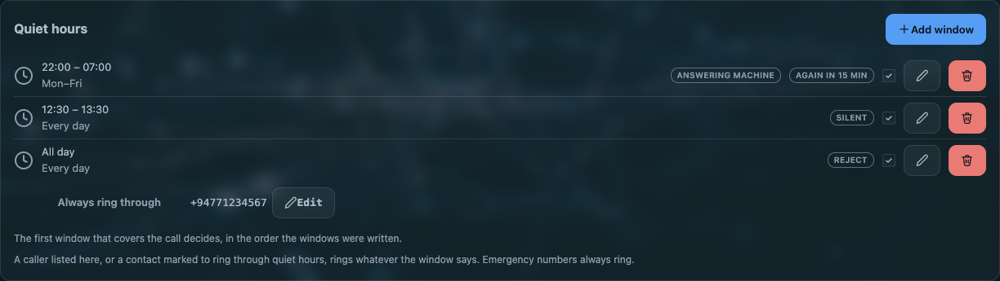

# Quiet hours

Quiet hours hold the **handset, the answering machine and the network phones** off a ringing call
for windows of the day you write. It is not a do-not-disturb flag on one device: it is the line
itself deciding not to make noise.

[](../assets/img/awvoice/quiet-hours.png)

The controls are on **Rules → Quiet hours**. Nothing is honoured out of the box: with no window
written, the phone rings at every hour.

## A window

| field | what it means |
|---|---|
| **Enabled** | a per-window switch, so you can keep a window written without it acting |
| **All day** | the whole 24 hours. The two time fields disappear when you tick it |
| **From / To** | `HH:MM` to `HH:MM`. A `from` later than its `to` runs **through midnight** — `22:00` to `07:00` is tonight into tomorrow morning, not nothing |
| **Days** | which weekdays count. Three-letter names only: `sun` `mon` `tue` `wed` `thu` `fri` `sat` |
| **Mode** | what happens to a call that arrives inside the window. See below |
| **Again in** | minutes before the same caller is let through again. New windows start at **15**; `0` turns that answer off |

Up to **eight** windows. **The first window that covers the moment decides**, in the order they are
written, so a narrow window has to sit above the broad one that would also match.

## The three modes

| mode | what happens to a call that arrives inside the window |
|---|---|
| **Silent** | the line stays silent. The page says *Call held quiet*, its **Answer** button takes the call, and lifting the handset answers it too |
| **Answering machine** | the call goes to the machine. This needs the machine switched on; with it off the caller hears nothing from this side until the network ends the call |
| **Reject** | the caller is released |

!!! warning "The machine mode is a promise you have to keep elsewhere"
    A window set to *Answering machine* on a router whose machine is off leaves the caller listening
    to nothing. If you want the machine to take night calls, switch it on in
    **Phone settings → Answering machine** as well.

## Who reaches you anyway

| | |
|---|---|
| **an emergency number** | always. Nothing on this router blocks one, whatever a window says |
| a number on the **ring through** list | the window's own list, and the page's *Always ring through* list, joined into one list of at most **twenty** numbers |
| a number of a **contact marked *Ring through quiet hours*** | recognised however the network happened to write the number, because the match is made in international form |
| **the same caller, again** | a caller who tries a second time inside the window's *Again in* minutes gets through. This is what makes a genuine emergency from a fixed line survive a silent window |

The *Always ring through* button is **disabled while no window exists** — there is nothing to ring
through to.

## Doing it by hand: `*78`, `*79` and `#`

| you dial | what happens |
|---|---|
| `*78` | ask for quiet now, whatever the windows say |
| `*79` | give that up |
| either, followed by `#` | the same, with the send key. Both forms are accepted |

They work on the handset **and** in the page's dialler. A hand-asked quiet is remembered across a
save of anything else, and falls back to the written windows when the service restarts — the ask is
not stored as a window.

## The clock rule

Nothing is honoured from a schedule before the router knows what time it is.

!!! info "An unknown clock never quiets the line"
    A router whose clock still reads 1970 would match every window or none, so with an untrusted
    clock the line rings normally. A quiet you asked for by hand needs no clock at all, because it is
    not a schedule.

The **Health** tab reports what the line answered a moment ago and what decided it: whether quiet is
on, the cause — `window`, `all-day` or `manual` — and what was asked for.

## Settings

Quiet hours are one `dnd` section per window in `/etc/config/awvoice`:

```ini
# one window: weekdays, 22:00 to 07:00, the machine answers, the same caller may try again in 15 minutes
config dnd 'night'
        option enabled '1'
        option from '22:00'
        option to '07:00'
        option days 'mon tue wed thu fri'
        option mode 'machine'
        option repeat_min '15'
        list allow '+94771234567'

config contact 'family'
        option name 'Family'
        option ring_through '1'
```

| option | values | default | meaning |
|---|---|---|---|
| `enabled` | `0`\|`1` | `1` on the page | does this window act |
| `from`, `to` | `HH:MM` | `22:00`, `07:00` on the page | the window. Past midnight is normal |
| `all_day` | `0`\|`1` | `0` | the whole day |
| `days` | three-letter weekday names | all seven on the page | which days |
| `mode` | `silent`, `machine`, `reject` | `silent` when unset | what happens inside |
| `repeat_min` | `0`–`1440` | `15` on the page | minutes before the same caller is let through; `0` is off |
| `allow` | a list of numbers | empty | ring through. Twenty across all windows |

A `contact` section with `ring_through '1'` needs nothing written in any window.

## When it does not do what you expect

| symptom | what it means |
|---|---|
| The phone rings during a window you wrote | the window's `enabled`, or its days, or an earlier window that also covers the moment and says something else |
| Nothing rings, ever | a window with `all_day`, or a window whose times cover 24 hours. Check the order |
| The caller hears nothing at all | mode is *Answering machine* and the machine is off, or mode is *Silent* and nobody takes it |
| A number on the ring-through list still gets held | the stored form does not match. Matching is done in international form, so `0771234567` and `+94771234567` are the same caller only when the numbering plan says so |
| Quiet came on at the wrong hour | the router's clock. Set your time zone |
| `*78` did nothing | the digits were collected as a dialled number. A service code needs to be dialled as a code, and the send key does not act inside it |

## Questions people ask

??? question "Can I stop the AW1000's phone from ringing at night?"
    Yes. **Rules → Quiet hours** takes up to eight windows with times, weekdays or all day, and three
    answers for a call that arrives inside one: stay silent, send it to the answering machine, or
    release the caller.

??? question "Can some numbers still get through quiet hours?"
    Yes: a per-window *ring through* list, a page-wide *Always ring through* list — twenty numbers
    across them — any contact marked **Ring through quiet hours**, and the same caller trying a
    second time within the window's repeat minutes.

??? question "Does quiet hours stop the answering machine too?"
    It depends on the window's mode. *Silent* holds everything quiet, *Answering machine* sends the
    call to the machine, and *Reject* releases the caller. The handset, the browser page and the
    network phones all follow the same decision.

??? question "What is *78 on a phone?"
    The code that asks for quiet now, without writing a window. `*79` gives it up. Both work on the
    handset and in the page's dialler, with or without the send key.
