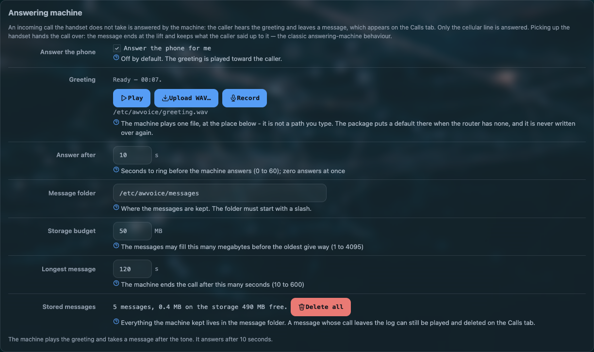

# Recordings and the answering machine

Both of these listen to a call the router already carries, and both are **off** until you switch
them on. They live on the **Settings** tab, and everything they produce is reachable from the
[call's own card](calls.md) rather than from a folder you have to remember.

[](../assets/img/awvoice/answering-machine.png)

!!! warning "Know the rules where you connect this"
    Recording a conversation is regulated almost everywhere, and often requires telling the other
    side. Nothing on this router announces that a call is being recorded — an announcement is a
    greeting you record and play yourself. Check what applies to you before you switch either
    feature on.

## Call recordings

| option | default | what it does |
|---|---|---|
| `record_enabled` | `0` | record the calls this line answers |
| `record_path` | `/etc/awvoice/recordings` | where the files go |
| `record_max_mb` | `50` | the folder's budget. Passing it removes the **oldest** files until the folder fits |

What a recording is:

| | |
|---|---|
| container | a WAV file, playable anywhere |
| channels | **stereo** — the caller on one channel, this side on the other, so the two are separable in any editor |
| rate | 16 kHz when HD voice is in use, 8 kHz otherwise. The file carries the rate the call actually came up at, not the wish |
| naming | `<epoch>-<call id>.wav`. **No file name ever carries a phone number** |
| what is captured | the call from the moment it is answered. A call that is never answered is not recorded; a call the machine answers becomes a message instead |
| where it is attached | the call's own card in the log, with **play**, **save** and **delete** |

!!! note "This side means the line, not the handset"
    The second channel is taken from the audio the router puts on the line, so a call answered from
    the browser page or a soft phone is recorded with that side's voice too. A handset that is on the
    table while a network phone talks records the network phone.

Recordings are kept on flash under `/etc/awvoice/`, which a keep-settings upgrade carries across.
The 50 MB budget is per folder and is deliberately small: this is a router with a fixed amount of
flash, and a recording folder that grows silently is the fastest way to fill it.

## The answering machine

| option | default | what it does |
|---|---|---|
| `machine_enabled` | `0` | let the line answer for you |
| `machine_delay` | `10` | seconds of ringing before the machine takes the call. `0` answers at once |
| `machine_max_s` | `120` | the longest single message |
| `machine_max_mb` | `50` | the folder's budget, oldest message removed past it |
| `machine_path` | `/etc/awvoice/messages` | where the messages go |

The machine answers, plays the greeting, and records what the caller says after the tone. Each
message is attached to the call it came from, so the log row tells you who rang, when, and that a
message is waiting.

### The greeting

There is exactly **one** greeting file, at a fixed place: `/etc/awvoice/greeting.wav`. It is not an
option, and there is no list of greetings.

| | |
|---|---|
| a new router | the package carries a short default greeting, and the first service start that finds nothing at that path copies it in. So the machine works the moment you switch it on |
| after that | the file is yours. An upgrade never writes over it |
| no greeting at all | the machine does not answer. Silence is the safe answer, not a beep into an empty line |

Three controls sit on the card, and each one has a rule the daemon enforces:

| control | what it does |
|---|---|
| **Play** | hears the file exactly as it stands on the router — including a file the machine cannot use, which is how you recognise one. Disabled when there is nothing there to read |
| **Upload WAV…** | the browser decodes and resamples to 8 kHz mono, so a recording from a phone or a computer in any usual rate works. The daemon checks the result again, writes a temporary file and moves it into place, so an interrupted upload cannot leave a half greeting |
| **Record** | takes your voice from the computer's microphone. The service trims the silence off both ends, adds a short gap, and adds the tone that tells the caller to start talking |

What the machine will accept:

| | |
|---|---|
| format | 16-bit PCM WAV |
| rate | 8 kHz or 16 kHz |
| size | at most 2 MB |
| if it cannot read it | the machine **switches itself off** rather than answer with noise, and the card says which file it found and what was wrong |

!!! tip "An uploaded file is kept as its author made it"
    The trim-and-tone treatment belongs to the **Record** path, because that one captures silence at
    both ends by accident. A file you upload or copy onto the router yourself is played as it is:
    whatever tone and pause you put in is what the caller hears.

The shell route, if you would rather keep your own recording out of the browser:

```sh
scp greeting.wav root@192.168.1.1:/etc/awvoice/greeting.wav
/etc/init.d/awvoice restart
```

### Taking a call over from the machine

Lift the handset while the machine is talking to a caller and the call becomes yours. The message
**ends at the lift**, and the rest of the conversation is not recorded — the same behaviour as a
standard voicemail system, kept deliberately: a call you are standing in the middle of is a call,
not a message.

The page's **Answer** button does the same thing from the browser, and the
[handset-wins-a-lift rule](web-phone.md#who-owns-the-line) decides what happens when both are
reaching for the same call.

## Hearing a message

A message is played from the call's card in the [log](calls.md), next to the caller's number and
the time it arrived: **play** in the browser, **save** the file, or **delete** it. There is no
separate voicemail page and no mailbox to log into.

## When it misbehaves

| symptom | what it means |
|---|---|
| The machine never answers | `machine_enabled` is off, or there is no readable greeting. The card says which |
| The card says the greeting cannot be used | the file is not 16-bit PCM, or its rate is not 8 or 16 kHz, or it is over 2 MB. **Play** still works, which is how you hear what is wrong |
| Callers hear nothing after the greeting | they are not talking yet, or the message cap was reached and the recording stopped. Check `machine_max_s` |
| Recording is on but no file appears | the call was not answered from this side. A missed call is never recorded |
| Old recordings disappeared | the size budget removed them. Raise `record_max_mb` if the folder is too small for how you work |
| The router's flash is filling | look at `/etc/awvoice/recordings` and `/etc/awvoice/messages` first: both are on flash, and both are the only large things this feature writes |

## Questions people ask

??? question "Does the AW1000 record phone calls?"
    It can, once you switch recording on. Each answered call is kept on the router as a stereo WAV —
    the caller and this side on separate channels — with a folder budget that removes the oldest.
    Nothing leaves the router, and no file name carries a number.

??? question "Can the AW1000 act as an answering machine?"
    Yes. After a delay you set, an unanswered call hears your greeting and leaves a message, which
    is played, saved or deleted from that call's card in the log. A greeting ships with the package,
    so it works the moment you switch it on.

??? question "What happens if I pick up while the machine is recording?"
    The call transfers to you and the message ends at the lift. The rest of the conversation is not
    recorded.

??? question "What audio format does the greeting need?"
    16-bit PCM WAV at 8 or 16 kHz, at most 2 MB. The page's upload path resamples for you; a file
    the machine cannot read switches the machine off instead of playing noise.
