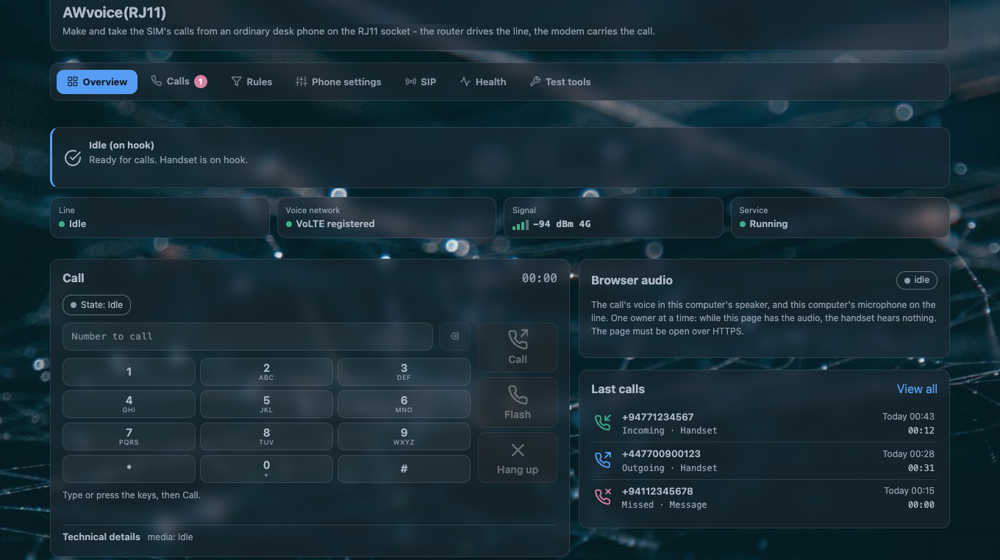

# The page, control by control

**Services → AWvoice(RJ11)**, seven tabs. The page reads the daemon over `ubus` and writes
`/etc/config/awvoice` and, on the SIP tab, `/etc/config/qmodem_sip` — the same files the shell does.

| | |
|---|---|
| refresh | every 1 second by default; *Phone settings → Advanced → Live view refresh* offers 1, 2, 3, 5, 10, 15, 30 seconds |
| deep links | the page remembers where you were: `#tab=calls`, `#tab=sip&sip=diag`, `#tab=rules&rules=qh` |
| the missed-call badge | on the *Calls* tab, and it is **kept in this browser only** — a second browser has its own idea of what you have seen |
| toasts | a saved message lasts 2.6 seconds |

## Overview

The line, the call, and the browser phone.

| block | what it shows |
|---|---|
| the state banner | one sentence for the moment, including *Call held quiet* and, during quiet hours, *"Quiet hours: a call from … is waiting. Answer on this page, or lift the handset."* |
| four tiles | **Line**, **Voice network** (VoLTE registered / Not registered / Unknown), **Signal** (bars from RSRP at −90, −100 and −110 dBm), **Service** |
| the call card | the page's own telephone: [the web phone](web-phone.md) |
| **Last calls** | the three newest rows, with **View all** into the Calls tab |

## Calls

The [call log](calls.md): search, *From date*, the six filter chips with counts, **Export CSV**,
**Clear all**, and one card per call with its recording or message.

The whole tab is drawn **disabled** when the running daemon does not answer the log method at all,
so an old daemon cannot be mistaken for an empty log.

## Rules

Four panes behind chips: [phone book, blocking, alarm calls](rules-and-phonebook.md) and
[quiet hours](quiet-hours.md). Each list editor saves on its own OK; nothing here is a page-wide
save.

## Phone settings

Ten cards, in this order. Every one of them writes on **Save and apply**.

| card | controls |
|---|---|
| **Line** | *Caller ID* (DTMF / FSK Bellcore / FSK ETSI / Off); *Caller-id timing* (after or before the first ring — **disabled unless the mode is one of the two FSK variants**); *My number*; *Dial pause*; *Hook-flash timing* (two fields) |
| **Tones** | *Ringback tone* (Automatic / Always play / Never play) |
| **Audio** | *Earpiece volume* (Modem default, then 0–5); *Microphone gain* and *Earpiece gain*, both **shown disabled with "Not available yet"** and never written; *HD voice* |
| **Features** | *Call waiting*; *3-way calling*; *Hotline* number and delay |
| **Recording** | *Record calls*; *Recording folder*; *Storage budget*; *Stored recordings* usage with **Delete all** — which settles each deletion and reports the count |
| **Answering machine** | *Answer the phone*; the **Greeting** card with *Play*, *Upload WAV…*, *Record* and the printed path `/etc/awvoice/greeting.wav`; *Answer after*; *Message folder*; *Storage budget*; *Longest message*; *Stored messages* with **Delete all**; and a live note that says what the machine will do |
| **Speed dial** | the contacts that carry a code, with **Add** and **Remove speed dial** |
| **Indicator** | *Phone LED*, built from the lamps the router actually has, plus *None*; *Call-blink rate*; *Off-hook blink rate* |
| **Advanced** | a folded card: *Modem receive gain*; *Modem USB interface*; *Live view refresh* |
| actions | **Save and apply**, then **Reset** (OpenWrt's own discard). Validation errors print in the tab's own line, including *"Hook-flash maximum must be at least 100 ms above the minimum"* and *"The messages cannot be kept in the recording folder. Choose another folder."* |

## SIP

Two panes behind chips, *Service* and *Diagnostics*, and a mode card above them. All of it is on
[network phones](network-phones.md).

| control | what it does |
|---|---|
| **Mode** — *Who may use the phone line* | the switch, with the outcome word beside it |
| **Show a Linphone QR code** | the [provisioning code](network-phones.md#the-code-a-phone-scans) |
| *Phones on this network call this router* | the inbound direction: network, port, account name, password, and **Create a new password** |
| *Calls through a SIP provider* | the outbound direction: network, port, provider address, realm, account, password, re-register interval |
| **Save and restart** | one action, with a modal that warns *"A call in progress drops while it restarts."* |
| **Read again** | re-reads the service's settings without writing anything |
| *Diagnostics* | the guards, who holds the front-end name, who holds the voice port, the last refusal, the browser audio state, and the service's own files and processes |

The audio path and the RTP range are deliberately **not** offered here: they belong to the service,
and this page does not reconfigure another program's settings.

## Health

What the hardware and the operating system actually reported. Field by field on
[health and tests](health-and-tests.md).

## Test tools

Three cards, all **disabled unless the line is idle**:

| card | what it does |
|---|---|
| **Ring test** | rings the handset for 5 seconds, after a confirmation that says *"Ring the handset for 5 seconds? Keep the handset on hook."* |
| **Line test** | three samples 100 ms apart and a verdict on the line's electrical state |
| **Test call** | loopback, so you hear your own voice after a short delay. This build does not offer it: the card is disabled and tagged *Not available yet* |

## What the page cannot do

| you might expect | the truth |
|---|---|
| take a call the **handset** is already holding | not offered. The page never interrupts a call in progress |
| change the SIP service's media socket | not offered. That file belongs to the service |
| set the microphone or earpiece gain | the fields are visible and disabled. They are not written |
| edit a call-forwarding rule | there is no forwarding pane. The network's own state is read and shown |
| see another browser's missed-call badge | the badge is per browser, on purpose |
