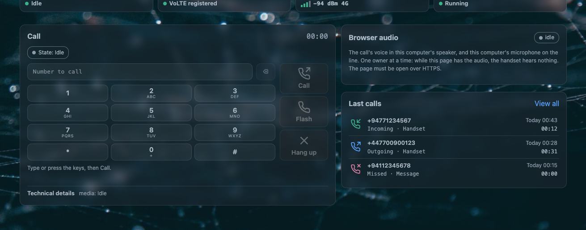

# The web phone

The **Overview** tab is not a status page that happens to mention calls. It is a handset: a keypad,
a three-button call rail, a flash key, a microphone mute and two level meters, carrying the same
line the RJ11 socket does.

With nothing plugged into the RJ11 socket, this is a complete telephone. That is not a fallback: the
line is carried by the modem, and the page is one of the three things that can hold it.

!!! note "The page must be open over HTTPS"
    A browser takes no microphone from a page it does not trust, and it sends audio to an encrypted
    socket only from an encrypted page. Open LuCI over `https://`.

## The controls

| control | what it does |
|---|---|
| the number field | what you are dialing. Up to 32 digits, with a backspace that deletes the last one |
| the **keypad** | `1`–`9`, `*`, `0`, `#` with their letter groups, and `0` giving `+` for an international prefix |
| **Call** / **Answer** | one button, in one slot. It is *Call* on an idle line and *Answer* while a call rings |
| **Flash** | the handset's flash key. Hold, swap, take the waiting call, take a held call back — and a digit typed after it is a code |
| **Hang up** / **Reject** / **Cancel** | the same slot again: *Hang up* in a call, *Reject* while a call rings, *Cancel* while your own attempt is still setting up |
| **Use this computer's microphone and speaker** | opens the audio session. Without it the call exists but you cannot hear it |
| **Mute** / **Unmute** | suspends the microphone alone. You still hear the caller |
| **Stop audio** | closes the session. The call goes on; the page just stops carrying it |
| the level meters | two live bars, so you can see both directions of audio while the call is up |
| **Technical details** | a folded row of counters: who owns the answer, the call revision, frames to the audio side, frames from it, frames dropped |

A control that cannot act right now keeps its place and is **disabled** rather than hidden, so the
layout never jumps under your cursor:

| when | what is disabled |
|---|---|
| a call is ringing in, or your own attempt is setting up, or the call is being torn down | the keypad |
| nothing is active, held or waiting | **Flash** |
| the handset, the answering machine or another front end already holds the answer | **Answer** |
| no audio session exists yet | **Mute** and **Stop audio** are not shown at all |

## Flash, and the codes that follow it

The page's **Flash** button stands in for a physical hook break, and the codes are the handset's:

| after the flash | what happens |
|---|---|
| `1` | end the current call and take the other one |
| `2` | hold this call and take the other; with two live calls it swaps them, with one held call it takes it back |
| `3` | join the two calls into a three-way conversation. Needs *3-way calling* switched on, which it is not as installed |
| `0` | refuse the waiting call, or release the held one |

The window for the digit is **three seconds**, and the page says so under the keypad while it is
open. This is the same window the handset's flash key uses, described on
[the handset page](handset.md#hook-flash-codes).

## Who owns the line

Two rules hold the whole thing together, and both are visible in the log.

**The handset wins a lift.** Lifting the handset during a page call carries the call on at the
phone. The log records the handset as the one that answered it, that call's card says so, and the
page's microphone and speaker stop with it. A call the *page* put on hold is not taken by a lift:
the lift gets the recall dial tone and the held call stays the page's.

**One owner of the playback ring.** Exactly one thing may send audio toward the caller at a time:
nothing, the greeting, a network phone, or this page. The handset sits on the same ladder, which is
why a lift ends a browser session cleanly instead of fighting it.

The page cannot take a call the handset already holds, and it never interrupts a call in progress.
What its **Answer** button *can* take over is the call the [answering machine](recordings-and-machine.md)
is holding — and taking it that way ends the message at that moment.

## The certificate step, once

The audio stream arrives on its own port, and a browser will not accept a self-signed certificate
silently on a port it has not seen before. So the page shows one button:

> **Open the audio address (one time)**

Press it, accept the browser's warning, close that tab. The browser then remembers the router's
certificate for the audio port and the step stays out of the way forever after. Until you do it, the
page says so plainly rather than letting you press *Use this computer's microphone* and wonder why
nothing happens.

## What the audio path is

!!! details "How the browser's voice reaches the line"
    One HTTP request becomes a WebSocket on the router's LAN address, port **7443** by default
    (`web_port`, `web_iface`), carrying this daemon's own frames: twelve header bytes — marker,
    version, type, sequence number, timestamp — followed by **160 samples of 16-bit linear audio in
    network byte order**, which is 20 ms at 8 kHz. At 16 kHz the same path carries two time samples
    per frame, packed the way the kernel reads them, so a wideband call is not stretched.

    Admission is a **token** minted by the daemon for the call revision the page is looking at:
    single use, valid thirty seconds, sent in the **first frame** of the encrypted stream — never in
    a URL, never in a log, never in a form field. A refused page is told which fixed reason applied:
    `refused-busy`, `refused-nocall`, `refused-revision`, `refused-mode`, `refused-rate`,
    `refused-port`, `refused-object`, `dropped-slow`.

    The stream is TLS on the router's own HTTPS certificate pair, which is
    `/etc/uhttpd.crt` and `/etc/uhttpd.key` unless you point it elsewhere.

**Why this is not WebRTC.** Three reasons, and they are all properties of this router rather than
preferences: the audio has to land **sample-exactly** inside the kernel's audio bridge and the
recording mirror, which a jitter buffer will not do; the allowed library set for this code stops
short of ICE, SRTP and Opus; and the peer is always on your own LAN, where there is no NAT to
traverse, no jitter to absorb and no codec negotiation to lose. A LAN stream that is 20 ms late is
broken, not adaptively degraded.

## What you hear from the page

- **your own ring**: a 1 kHz double burst every four seconds while a call rings, started only after
  you have interacted with the page, because a browser refuses sound until then;
- **progress tones** from the line itself, in the call audio;
- **nothing at all** if the audio session is not open — a call can be up with the page showing its
  state and no sound, which is the *Stop audio* state, not a fault.

## When the page's phone misbehaves

| symptom | what it means |
|---|---|
| **Use this computer's microphone** does nothing | the browser refused the microphone, or the page is not over HTTPS |
| The button is there but audio never starts | the certificate step has not been done in this browser. Press **Open the audio address (one time)** |
| You dial and the call sets up, but you hear nothing | the audio session is not open, or it was stopped. The meters being flat both ways is the tell |
| You hear the caller and they cannot hear you | the microphone is muted, or the browser revoked it mid-call |
| **Answer** is greyed out while a call rings | the handset is already off hook, or another front end holds the answer. That is the ownership rule, not a bug |
| The page says the phone side is not running | the daemon is down. The card offers the **Health tab**, where you can start it |
| A call the page held is not taken by lifting the handset | correct: a lift gets the recall dial tone, and the page's held call stays the page's |

## Questions people ask

??? question "Can I make phone calls without an analog handset on the AW1000?"
    Yes. With nothing in the RJ11 socket the AWvoice page is the telephone: dial from its keypad,
    answer with its **Answer** button, hang up, mute, and send DTMF. A soft phone on your own network
    is a third option once the SIP switch is on.

??? question "Does the browser phone use WebRTC?"
    No. It uses an encrypted WebSocket on the LAN carrying this daemon's own 20 ms audio frames,
    admitted by a single-use token. The reason is that the audio has to be placed sample-exactly into
    the kernel bridge and the recording mirror, and a LAN peer needs none of what WebRTC exists for.

??? question "Why does my browser ask for a certificate warning just for audio?"
    The audio stream is a second port with the router's own self-signed certificate. Accepting it
    once, through the page's **Open the audio address** button, is the whole setup.

??? question "Can two people use the phone at once — the handset and the page?"
    One of them owns the audio at a time. Lifting the handset during a page call carries the call on
    at the phone and stops the page's microphone and speaker.
