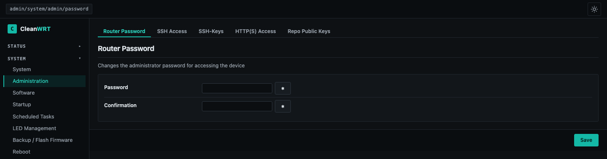
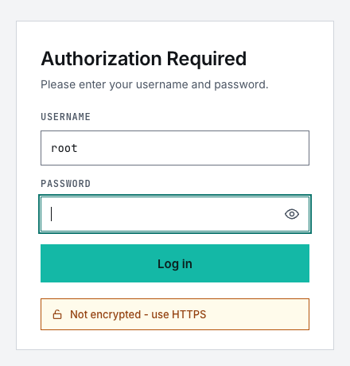

# First boot

CleanWRT follows the stock OpenWrt first-login model.

## Defaults

| | |
|---|---|
| Address | `192.168.1.1` |
| Hostname | `CleanWRT` |
| Root password | **none** (set it on first login) |
| Wi-Fi | on, WPA2-PSK, networks `CleanWRT-2.4G`, `CleanWRT-5G` (and `CleanWRT-6G` on a 6 GHz radio) |
| Default Wi-Fi key | `CleanWRT#40` |
| Time zone | UTC (set yours in LuCI) |
| Admin UI | LuCI over HTTPS (self-signed certificate) |
| Opt-in apps | installed, **disabled** |

!!! warning "Change both on the first login"
    Anyone who knows the default Wi-Fi key can join your network, and with no root password
    anyone on the LAN can log in. Do the steps below before you connect the router to
    anything you do not trust.

## Steps

1. Connect a computer to a LAN port with **Ethernet**. Do not use Wi-Fi for the first login.
2. Open `http://192.168.1.1`. The browser is moved to HTTPS and shows a certificate warning.
   That is expected, see [Security](features/security.md#why-the-browser-says-not-secure).
3. LuCI asks you to set a root password. Set a strong one. It applies to LuCI and SSH.
4. Change the Wi-Fi key: *Network → Wireless*, edit each interface, *Wireless Security*.

    ```sh
    uci set wireless.default_radio0.key='your-strong-key'
    uci set wireless.default_radio1.key='your-strong-key'
    uci commit wireless && wifi reload
    ```

5. Set your time zone: *System → System → General Settings*.
6. Open *Modem* and check that the 5G modem registered. See [The 5G modem](modem.md).

The root password is set under *System → Administration*:

[](assets/img/password-dark.png)

Upgrades with *keep settings* never overwrite a key you have set yourself.

The login page, in dark and light mode:

| Dark | Light |
|---|---|
|  |  |

## A short tour of LuCI

| Menu | What is there |
|---|---|
| Status | overview widgets (system, modem, memory, storage), logs, traffic |
| System | administration, mount points, **LED Management**, theme |
| Services | Passwall, HomeProxy, Tailscale, Cloudflare Tunnel, Adblock, AdGuard Home, Syncthing, qBittorrent, miniDLNA, Disk Manager |
| Network | interfaces, wireless, firewall, SQM, file sharing |
| Modem | QModem, 3gInfo-lite, SMS, TTL |
| Services → AWvoice(RJ11) | [AWvoice](awvoice.md): the phone port |
| VPN | OpenVPN |
| Tools | file manager, bandwidth monitor, watchcat, terminal |

## Turning on an app

Every opt-in app has the same single switch: open its LuCI page, tick **Enable**, press
**Save & Apply**. Set any passwords the app needs *before* you enable it. See
[What is included](included.md).
