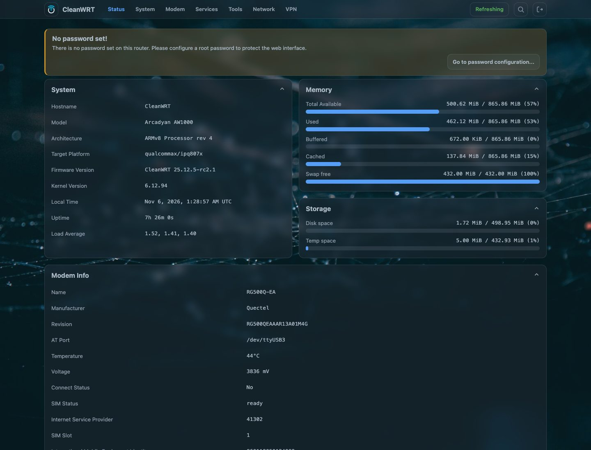
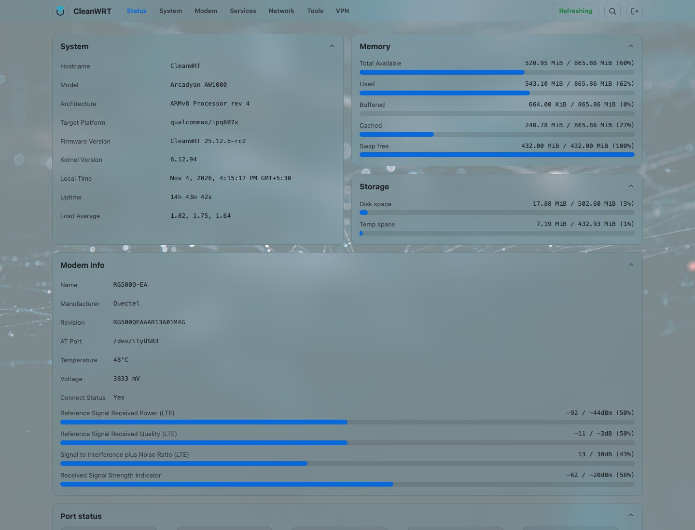
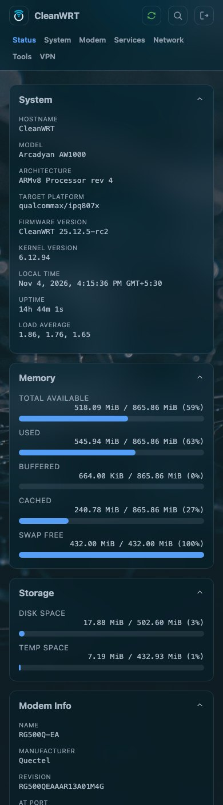

# CleanWRT: OpenWrt for the Arcadyan AW1000

**CleanWRT** is an independent, community build of OpenWrt 25.12.5 for the
**Arcadyan AW1000** 5G router (Qualcomm IPQ8072, Quectel RG500Q-EA modem). It adds
**AWvoice**, which turns the RJ11 socket into a working phone line, a working 5G stack, a modern
interface and a curated set of opt-in apps to stock OpenWrt. It is built in the open on GitHub from
pinned sources.

If you own an AW1000 and want OpenWrt on it, with a desk phone on the RJ11 socket and a 5G link
that reconnects on its own, this is the place to start. The pages below take you from "is my
router supported?" to a flashed, working router, and tell you how to get out if something goes wrong.

!!! note "Not affiliated with OpenWrt"
    CleanWRT is *Powered by OpenWrt* and is not affiliated with or endorsed by the OpenWrt
    project. OpenWrt® is a registered trademark of Software Freedom Conservancy (SFC).

-   **Plug in a phone: AWvoice**

    ---

    Use a normal desk phone on the router's RJ11 socket and make calls over your SIM. No extra box,
    no PBX, no SIP account. The router's own web page is a telephone too, and works with the socket
    empty.

    [:octicons-arrow-right-24: The phone port](awvoice.md)

-   **Install it**

    ---

    Flash from the stock firmware (UART + TFTP) or from an existing OpenWrt install.

    [:octicons-arrow-right-24: Installation](installation.md)

-   **Check the layout first**

    ---

    The image needs the *expanded* flash layout. Flashing it on the stock layout can brick the router.

    [:octicons-arrow-right-24: MTD layout](mtd-layout.md)

-   **Know the way back**

    ---

    Failsafe, U-Boot, serial console. Read this *before* you flash, not after.

    [:octicons-arrow-right-24: Recovery](recovery.md)

-   **Use the 5G modem**

    ---

    QModem, signal details, SMS, TTL, and what a modem firmware upgrade involves.

    [:octicons-arrow-right-24: The 5G modem](modem.md)

## A look at CleanWRT

=== "Dark"

    

=== "Light"

    

=== "On a phone"

    { width="300" }

!!! info "About the screenshots"
    The screenshots in this documentation were taken from a real AW1000 running this firmware. The
    numbers in them - uptime, memory, storage, signal - belong to the moment they were taken and
    will differ on your router.

## What you get on top of stock OpenWrt

- **AWvoice, phone calls on the RJ11 port:** an ordinary desk phone makes and takes calls over the
  SIM, with caller id, call waiting, hold, recall of a held call, a call log, call recordings, an
  answering machine, speed dial, call blocking and alarm calls. Three things can hold the line —
  the handset, the browser page, and a soft phone on your own network — and the socket can be empty.
  See [the phone port](awvoice.md), and its [quiet hours](awvoice/quiet-hours.md).
- **A 5G stack that works out of the box:** QModem UI, auto-dial, dual-stack IPv4/IPv6 data,
  TTL control, SMS, a registration fix for data-only SIMs, per-interface vnStat accounting.
- **A modern interface:** the [Footstrap theme](theme.md) with dark and light mode, a top bar or a
  sidebar, five palettes, an accent colour of your choice and a photo or pattern behind the pages.
- **Real front-panel LEDs:** a small daemon that shows 5G type, signal quality and internet
  reachability, with a night mode. See [Front-panel LEDs](leds.md).
- **Proxy and VPN tools:** HomeProxy, WireGuard, OpenVPN, Tailscale and
  Cloudflare Tunnel, all installed and all off until you configure them.
- **Opt-in apps:** file sharing, DLNA, printer server, Syncthing, qBittorrent
  and more. Nothing listens on your network until you tick **Enable**.
- **Safe defaults:** LuCI over HTTPS, BBR congestion control, no open services, no hidden
  remote access.
- **Verifiable releases:** every release has checksums and a provenance bundle (the full build
  configuration, the pinned sources and the package manifest).

## Status

CleanWRT's current release is `25.12.5-R2.1`, the second stable release of the OpenWrt 25.12.5
base; `rc1`, `rc2` and `rc2.1` were the candidates before it. The image is built on GitHub
Actions from the sources pinned in the repository. Read the [known limits](faq.md#known-limits)
before relying on it for anything important.

## Where to go next

| I want to... | Go to |
|---|---|
| use a phone on the router | [the phone port](awvoice.md) |
| make calls with nothing in the RJ11 socket | [the web phone](awvoice/web-phone.md) |
| know what the image writes on first boot | [first-boot defaults](reference/uci-defaults.md) |
| look up an option or a port | [UCI options](reference/options.md), [files and ports](reference/files-and-ports.md) |
| download an image and check it | [Releases](releases.md) |
| know if my router is supported | [Hardware](hardware.md) |
| flash it | [Installation](installation.md) |
| set it up after flashing | [First boot](first-boot.md) |
| see what apps are included | [What is included](included.md) |
| build it myself | [Build from source](building.md) |
| fix something | [FAQ and troubleshooting](faq.md) |
| see the source code | [Repositories](repositories.md) |

## Common questions

??? question "What is CleanWRT?"
    CleanWRT is an independent build of OpenWrt 25.12.5 for the Arcadyan AW1000 5G router. On top of stock OpenWrt it adds a working RJ11 phone port (AWvoice), a 5G modem stack that dials and recovers by itself, the Footstrap theme, front-panel LED management and a set of apps that stay off until you enable them.

??? question "Which routers does CleanWRT support?"
    Only the Arcadyan AW1000 (the Telstra variant) with the expanded flash layout. Never flash it on another router, because an image built for a different partition table can brick the device. See [Hardware](hardware.md) and [MTD layout](mtd-layout.md).

??? question "How is CleanWRT different from stock OpenWrt on the AW1000?"
    It is OpenWrt 25.12.5 with the AW1000 pieces already working: the phone port with VoLTE calls, QModem for the 5G modem, a modern dark and light interface, LEDs that show 5G type and signal quality, and VPN and proxy tools that are installed but off by default.

??? question "Is CleanWRT free to use?"
    Yes. The build configuration, patches and scripts are GPL-2.0-only. The bundled packages keep their own licences, and QModem adds a non-commercial clause, so read [Licence and notices](licence.md) before any business use.

