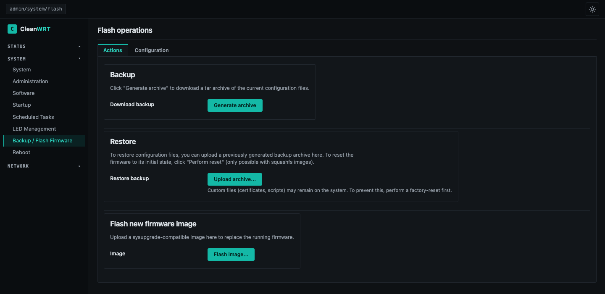

# Installation

!!! danger "Read this page fully before you start"
    Supported hardware is the **Arcadyan AW1000 only**. Flashing the wrong image or flashing
    on the wrong flash layout can brick the router. Read [MTD layout](mtd-layout.md) and
    [Recovery](recovery.md) *before* you flash.

There are two situations:

1. **The router already runs OpenWrt** (stock OpenWrt 25.12.x or an earlier CleanWRT). Go to
   [Already on OpenWrt](#already-on-openwrt-sysupgrade).
2. **The router runs the stock (Telstra) firmware.** The first OpenWrt install needs serial
   console (UART) access. Go to [First install from stock](#first-install-from-stock-firmware-uart-tftp).

## What you need for a first install

- A **3.3 V USB-UART adapter**. Do not use 5 V logic. Plus a few wires.
- A Phillips screwdriver to open the case, and a look at the [UART guide](uart.md) to find
  the pads.
- A **TFTP server** on your computer (`atftpd`, `tftpd-hpa`, or `dnsmasq --enable-tftp`) with a
  fixed IP in the router's LAN range (factory default `192.168.1.x`).
- Two files from a release (see [Releases](releases.md)):
    - `…-initramfs-uImage.itb`, the boot-in-RAM image for the first install
    - `…-squashfs-sysupgrade.bin`, the permanent image
- An Ethernet cable. The first login is over Ethernet.

## First install from stock firmware (UART + TFTP)

1. Open the case, connect the UART adapter (3.3 V!) and open a serial terminal at
   **115200 8N1** (`screen /dev/ttyUSB0 115200`, or PuTTY).
2. Power the router on and **interrupt U-Boot** when the countdown appears (press a key).
3. Tell U-Boot the router's IP and your TFTP server's IP:

    ```
    setenv ipaddr 192.168.1.1
    setenv serverip 192.168.1.10   # your computer running TFTP
    ```

4. Boot the initramfs image from RAM:

    ```
    tftpboot ${loadaddr} <initramfs-image-name>.itb
    bootm ${loadaddr}
    ```

5. The router boots a live OpenWrt from RAM. Flash the permanent image **from this live
   system**, over the network:

    ```sh
    # from your computer
    scp *-squashfs-sysupgrade.bin root@192.168.1.1:/tmp/
    # on the router
    sysupgrade -v /tmp/*-squashfs-sysupgrade.bin
    ```

6. The router reboots into the permanent firmware. Continue with [First boot](first-boot.md).

!!! warning "The no-UART shortcut"
    On very old stock firmware revisions a community "autoscript" method exists (flashing via
    a crafted USB update file, no UART). It is not maintained here, the older methods are
    reported to be patched on newer stock firmware, and a wrong image for your flash layout can brick the device.
    Prefer UART + TFTP.

## Already on OpenWrt (sysupgrade)

```sh
scp *-arcadyan_aw1000-squashfs-sysupgrade.bin root@192.168.1.1:/tmp/
ssh root@192.168.1.1 "sysupgrade -v /tmp/*-sysupgrade.bin"
```

- **Keep settings** (the default): your configuration survives. This is fine between CleanWRT
  releases.
- **Clean install** (`sysupgrade -n`): wipes the overlay. Use it when changing major
  versions, when the UI misbehaves, or when coming from a much older build. It also puts the
  default credentials back (see [First boot](first-boot.md)).

You can also upload the image in LuCI, under *System → Backup / Flash Firmware → Flash image…*.

[](assets/img/flash-dark.png)

Before flashing from OpenWrt, check the layout:

```sh
cat /proc/mtd
```

The `rootfs` partition must be at least `0x08000000` (128 MiB). Otherwise stop. See
[MTD layout](mtd-layout.md).

## After flashing

- Open `http://192.168.1.1` over Ethernet and follow [First boot](first-boot.md).
- Check the version in the login banner or *Status → Overview*.
- If something is wrong, go to [Recovery](recovery.md).
