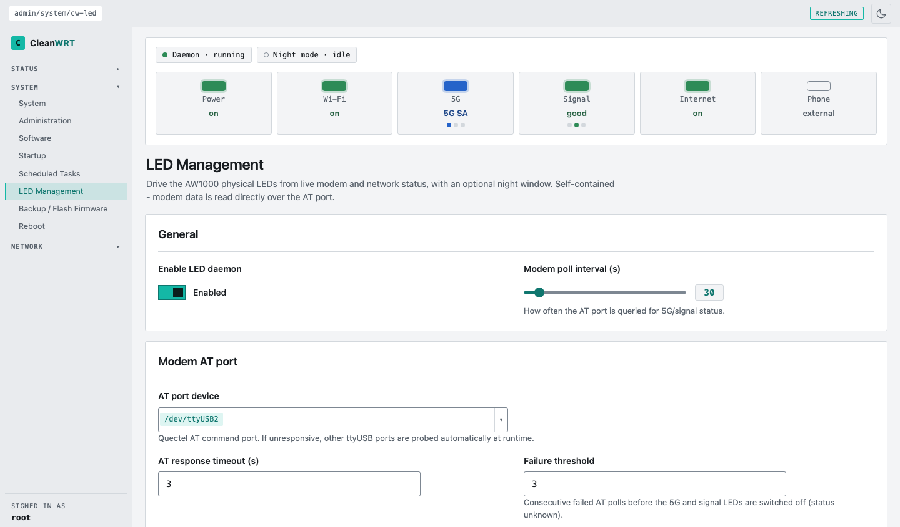
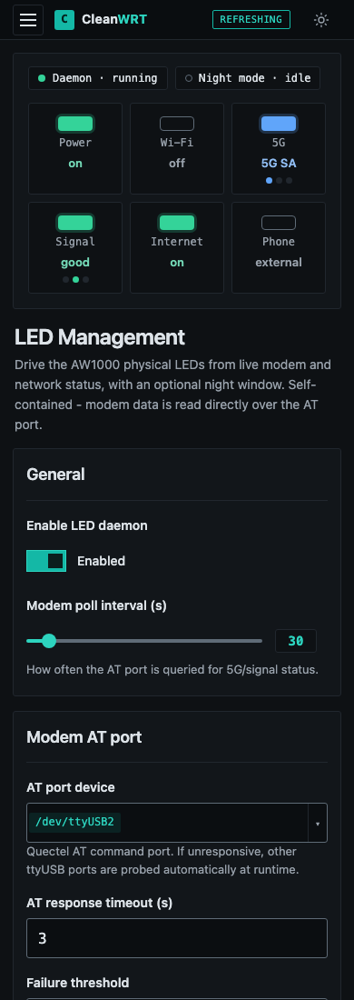
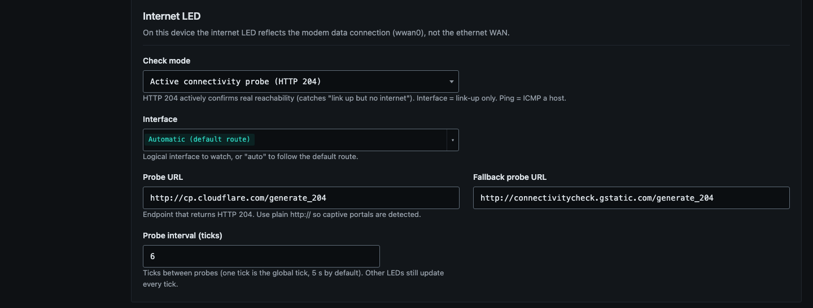
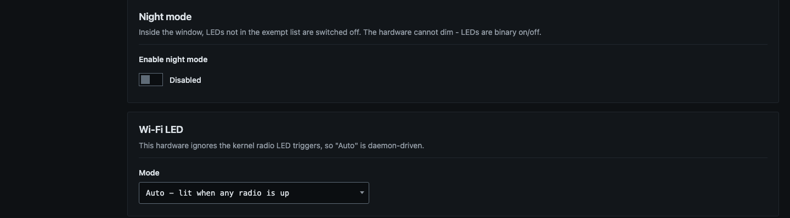

# Front-panel LEDs

CleanWRT replaces the stock *LED Configuration* page with **LED Management**
(*System → LED Management*), backed by a small daemon, `cw-led-daemon`. The package is
[`luci-app-cw-led`](https://github.com/Pr0Luci/luci-app-cw-led).

The LEDs on this board are on/off only (no dimming).

## The status card

The top of the page shows the live state of the LEDs, refreshed every few seconds, so you can see
what the panel shows without looking at the router.

=== "Dark"

    [](assets/img/leds-dark-status.png)

=== "Light"

    [](assets/img/leds-light-status.png)

=== "On a phone"

    [](assets/img/leds-mobile.png){ width="300" }

!!! info "About the screenshots"
    The screenshots in this documentation were taken from a development preview of the interface
    (the same theme, pages and LED app as the firmware) running on a computer, with a simulated
    modem. Values such as the kernel, memory and storage differ on a real router.

## What each LED shows

| LED | Shows |
|---|---|
| **Power** | always on |
| **Wi-Fi** | on while any radio is up. In *single interface* mode it blinks with traffic on one interface. |
| **5G** | 5G type only: **solid blue** = 5G standalone (SA), **solid green** = 5G non-standalone (NSA), **off** for anything else (4G, 3G, no service, unknown). There is no red on this LED. |
| **Signal** | **green** good, **blue** average, **red** poor; **flashing red** while the modem is connecting or the SIM has a fault; **off** when the service is unavailable. |
| **Internet** | **on** while the connectivity check says the uplink really reaches the internet. |

The phone LED is not controlled by this app: it belongs to [AWvoice](awvoice.md). When AWvoice is
running it is solid while the line is ready, blinks fast while a call rings and blinks slowly while
the handset is off hook.

### How signal quality is decided

The signal LED uses RSRP (in dBm), with CSQ as a fallback when RSRP is unavailable. The limits are
settings:

| | Excellent (green) | Poor (red) | Between (blue) |
|---|---|---|---|
| RSRP | at or above `-95` | at or below `-110` | in between |
| CSQ | at or above `20` | at or below `9` | in between |

### How the internet LED is decided

[](assets/img/leds-dark-internet.png)

*Active connectivity probe (HTTP 204)* is the default and the most accurate. The daemon asks a
test address for an empty "204" answer; anything else (a captive portal page, a redirect, a
timeout) means "no internet". It catches the case where the link is up but there is no real
connectivity. Two other modes exist: *Default-route interface is up* (link state only) and *Ping
a host*.

- One good probe turns the LED on quickly. It takes two failed probes in a row to turn it off,
  so a single dropped probe does not flicker the LED.
- It follows the routing table and is not bound to one network device, so it works behind a
  transparent proxy on the router.

## Night mode

Night mode switches chosen LEDs off between two times of day.

[](assets/img/leds-dark-night.png)

| Setting | Default |
|---|---|
| Enabled | off |
| Window | `22:30` to `06:00` (a window past midnight is supported) |
| Keep on during night | all five LEDs are on the list, so nothing is dimmed until you remove entries |

Remove an LED from *Keep on during night* to switch it off inside the window.

## Settings

All settings are on the *LED Management* page and stored in `/etc/config/cw-led`.

| Section | Option | Default | Meaning |
|---|---|---|---|
| General | enabled | on | run the daemon |
| General | poll_interval | 30 | seconds between modem polls |
| Modem | port | `/dev/ttyUSB2` | AT port. If it does not answer, the daemon tries `ttyUSB3`, `ttyUSB1`, `ttyUSB0`. |
| Modem | timeout | 3 | AT response timeout (s) |
| Modem | fail_threshold | 3 | failed polls in a row before 5G and signal LEDs go off |
| Modem | grace_max_ticks | 2 | polls to keep the last colour when a reply is cut short (0 = off) |
| Internet | mode | http204 | `http204`, `interface` or `ping` |
| Internet | probe_url | `http://cp.cloudflare.com/generate_204` | test address, plain `http://` so captive portals are detected |

Restart the service after editing the file by hand:

```sh
/etc/init.d/cw-led restart
```

## Troubleshooting

!!! tip "Read the log"
    Every change of the 5G or signal colour is logged with the modem state:
    `logread -e cw-led`

| Symptom | Likely cause |
|---|---|
| 5G and signal LEDs are off | the modem is unreachable on the AT port. Check the port in the settings and that nothing else holds it open. |
| LEDs flicker or go blank for a moment | another program reads the same AT port. The default `ttyUSB2` is chosen so QModem (on `ttyUSB3`) does not share it. |
| Internet LED stays off though the internet works | the probe address is blocked. Change *Probe URL* or switch to *Default-route interface is up*. |
| Wi-Fi LED off with the radios up | in *single interface* mode the LED follows one interface only. Use *Auto*. |

If the daemon stops, the power and Wi-Fi LEDs return to their normal kernel triggers and the
daemon-owned LEDs are turned off.

## Under the hood

The daemon reads the modem directly over the AT port with plain shell, so no other app is
needed. It writes the LED state through sysfs, only when something changes. The source is in the
[`luci-app-cw-led`](https://github.com/Pr0Luci/luci-app-cw-led) repository.
