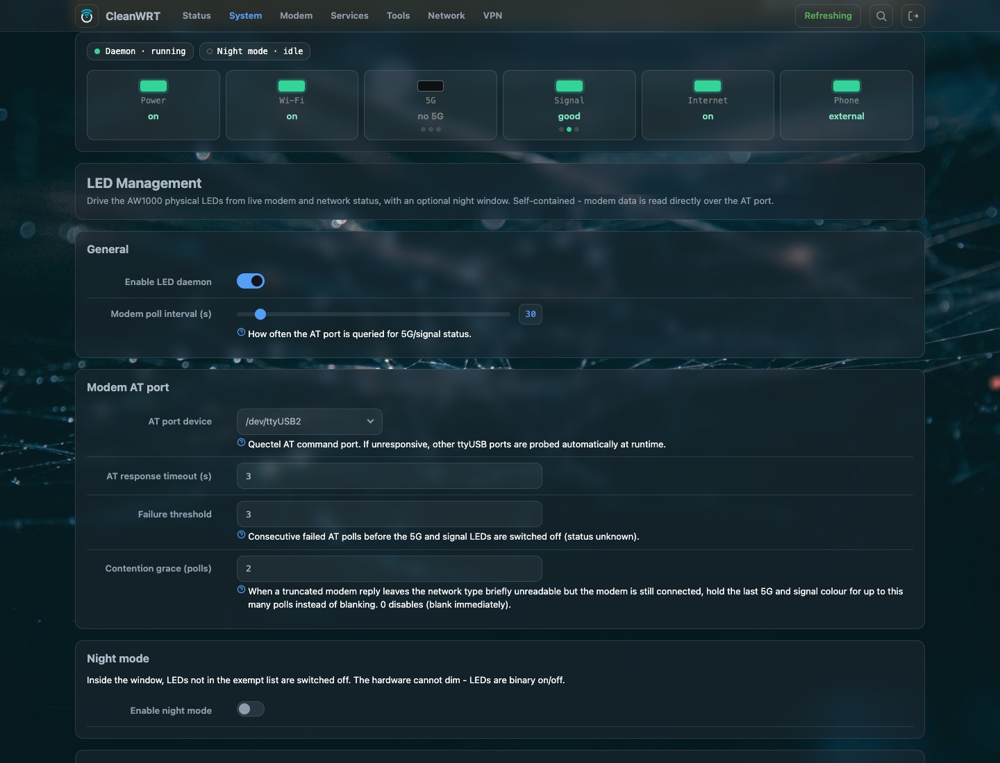
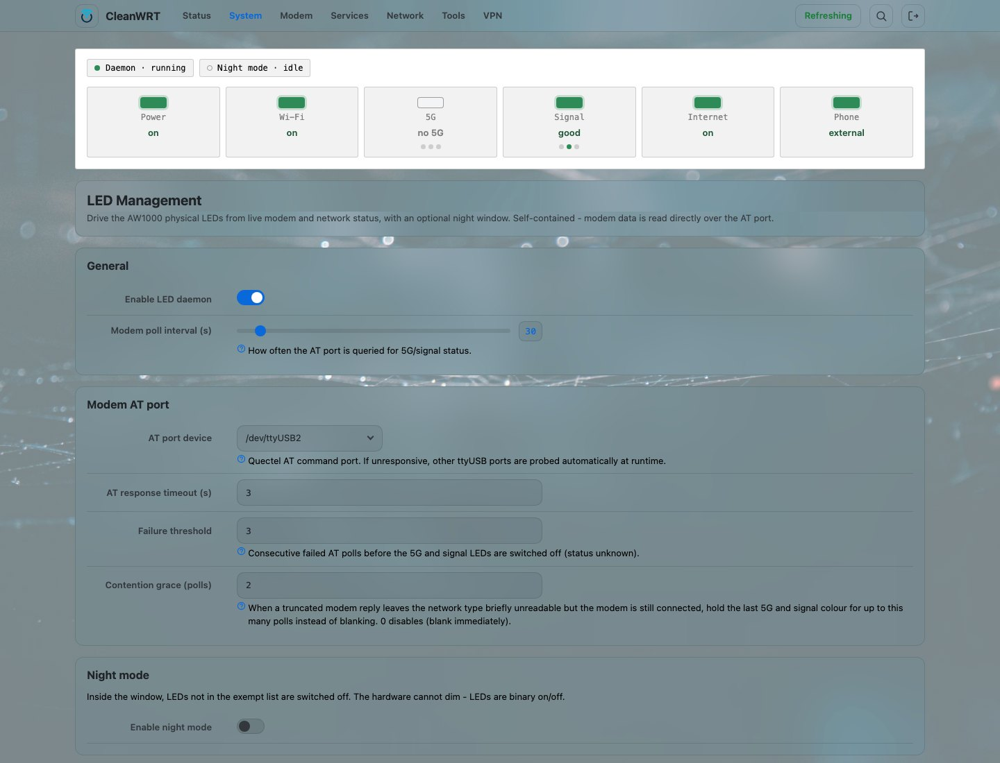
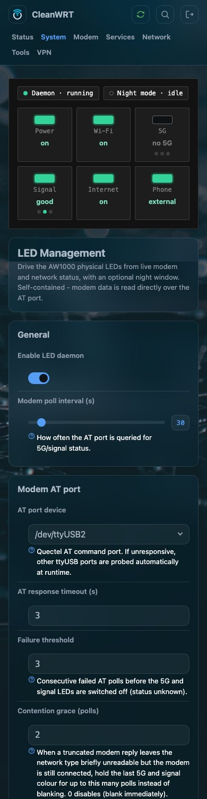
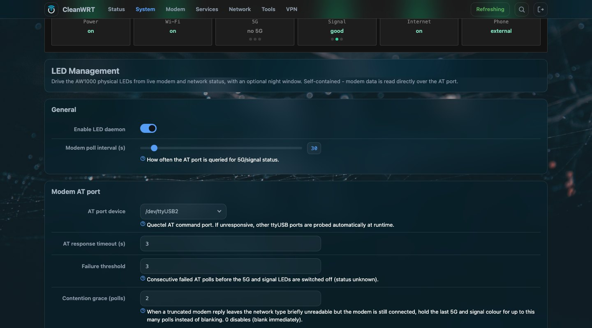
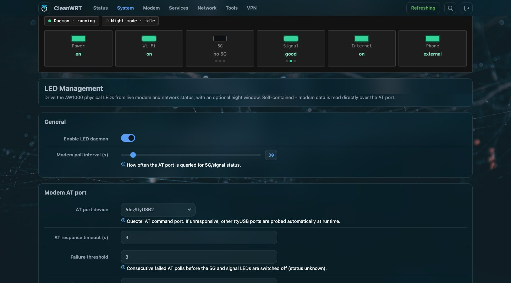

# Front-panel LEDs

CleanWRT replaces the stock *LED Configuration* page with **LED Management**
(**System → LED Management**), backed by one small daemon, `cw-led-daemon`. The package is
[`luci-app-cw-led`](https://github.com/Pr0Luci/luci-app-cw-led), pinned in this build to one commit.

The LEDs on this board are **on or off**: there is no dimming anywhere in the hardware, so every
state you see is a lit lamp, an unlit lamp, or a blink.

## The status card

The top of the page shows what the panel is doing right now, refreshed every five seconds, so you
can watch the router's state without walking to it.

=== "Dark"

    [](assets/img/leds-dark-status.jpg)

=== "Light"

    [](assets/img/leds-light-status.jpg)

=== "On a phone"

    [](assets/img/leds-mobile.jpg){ width="300" }

Two chips above the lamps say whether the daemon is running and whether the night window is open.
Six tiles show the lamps. The sixth, **Phone**, is read-only: this app reports what the phone
service owns but never writes it.

!!! info "About the screenshots"
    These were taken from a real AW1000 running this firmware. The states in them belong to the
    moment they were taken.

## What each LED shows

| LED | Shows |
|---|---|
| **Power** | always on |
| **Wi-Fi** | on while any radio is up. In *Single interface* mode it blinks with traffic on the interface you choose |
| **5G** | the 5G type only: **solid blue** = 5G standalone (SA), **solid green** = 5G non-standalone (NSA), **off** for anything else — 4G, 3G, no service, unknown. There is no red on this lamp. While the very first modem read is still running it flashes red at 1 Hz |
| **Signal** | **green** good, **blue** average, **red** poor; **flashing red** while the modem is searching or the SIM has a fault; **off** when the service is unavailable |
| **Internet** | on while the connectivity check says the uplink really reaches the internet |
| **Phone** | not this app's lamp. While [AWvoice](awvoice.md) is running it is solid while the line is ready, blinks fast while a call rings and blinks slowly while the handset is off hook |

The WAN ethernet port's own lamp is left exactly as the kernel drives it.

### How signal quality is decided

Signal uses RSRP in dBm, with CSQ as a fallback when RSRP does not come back. The four limits are
settings.

| | excellent (green) | poor (red) | in between (blue) |
|---|---|---|---|
| RSRP | at or above `-95` | at or below `-110` | between the two |
| CSQ | at or above `20` | at or below `9` | between the two |

The page draws the scale (`−44` to `−140`) so you can see where your reading sits, and refuses a
pair where the poor threshold is not below the excellent one.

### How the 5G type is read

One AT command answers the question: `AT+QENG="servingcell"`. A `NR5G-SA` line is standalone, a
`NR5G-NSA` line is non-standalone, `LTE` or a 3G line is not 5G, and a reply that names no cell at
all leaves the lamp off. `AT+CSQ` is asked only when the serving-cell reply carried no usable RSRP,
and `AT+CEREG?` and `AT+CPIN?` only while the modem is not registered — fewer queries on a port
other programs also use.

### How the internet LED is decided

[](assets/img/leds-dark-internet.jpg)

*Active connectivity probe (HTTP 204)* is the default and the most accurate: the daemon asks a test
address for an empty `204` answer, and anything else — a captive-portal page, a redirect, a timeout
— means there is no internet. That catches the case where the link is up but nothing is reachable,
which a link-state check cannot see.

- One good probe turns the lamp on at once. **Two** failed probes in a row are needed to turn it
  off, so one dropped probe does not flicker it. Both numbers are settings.
- The probe follows the default route and is not bound to one device, so it still works behind a
  transparent proxy on this router.
- The plain `http://` in the default addresses is deliberate: a captive portal answers an HTTPS
  request with a certificate error and tells you nothing.
- On this device the internet lamp reflects the modem data path, not an ethernet WAN.

The other two modes are *Default-route interface is up*, which is link state only, and *Ping a
host*, which defaults to `1.1.1.1`.

## Night mode

Night mode switches the lamps you choose off between two times of day.

[](assets/img/leds-dark-night.jpg)

| setting | default |
|---|---|
| Enabled | off |
| Window | `22:30` to `06:00`. A window that runs past midnight is normal, not an error |
| Keep on during night | all five daemon-owned lamps are on the list, so nothing goes dark until you remove one |

The page draws the window as a timeline so you can see it, and hides the window controls entirely
until night mode is enabled. Entering the window forces every non-exempt lamp off; leaving it
re-reads the modem and re-probes at once, so the panel is current again the minute the window closes.

!!! note "The phone lamp is not in the night list"
    Night mode here does not touch the phone lamp, and it is not bound to the theme's night behaviour
    either. A line that must stay silent at night is a
    [quiet hours](awvoice/quiet-hours.md) question, which is answered on the phone's own page.

## Settings

Everything is on the page and stored in `/etc/config/cw-led`.

| section | option | on the page as | default | meaning |
|---|---|---|---|---|
| General | `enabled` | Enable LED daemon | `1` | run the daemon at all |
| General | `poll_interval` | Modem poll interval (s) | `30` | seconds between modem polls. A slider from 10 to 300 |
| General | `tick` | — | `5` | the daemon's own clock in seconds. Everything timed in ticks is measured against it |
| General | `log_heartbeat_min` | — | `0` | write a status line this often; `0` is silent |
| Modem AT port | `port` | AT port device | `/dev/ttyUSB2` | the AT port the daemon reads. If it does not answer, `ttyUSB3`, `ttyUSB1`, `ttyUSB0` are tried at runtime; the file is never rewritten |
| Modem AT port | `timeout` | AT response timeout (s) | `3` | how long one AT reply may take |
| Modem AT port | `fail_threshold` | Failure threshold | `3` | failed polls in a row before the 5G and signal lamps go off |
| Modem AT port | `grace_max_ticks` | Contention grace (polls) | `2` | polls for which the last colour is held when a reply is cut short but the modem is provably serving. `0` blanks at once |
| Night | `enabled`, `start`, `end`, `exempt` | Night mode | `0`, `22:30`, `06:00`, all five lamps | see [night mode](#night-mode) |
| Wi-Fi | `mode` | Mode | `auto` | `auto` is daemon-driven from the radios, because the Wi-Fi driver here ignores the kernel's per-radio triggers. `netdev` puts the kernel's traffic trigger on one interface |
| Wi-Fi | `device` | Wi-Fi interface | unset = first found | only shown in `netdev` mode |
| Signal | `rsrp_excellent`, `rsrp_poor` | RSRP thresholds | `-95`, `-110` | the green and red limits |
| Signal | `csq_excellent`, `csq_poor` | CSQ thresholds | `20`, `9` | the same, when RSRP is missing |
| Internet | `mode` | Check mode | `http204` | `http204`, `interface` or `ping` |
| Internet | `iface` | Interface | `auto` | which interface the check follows |
| Internet | `ping_host` | Ping host | `1.1.1.1` | used by `ping` mode |
| Internet | `probe_url` | Probe URL | `http://cp.cloudflare.com/generate_204` | the address the probe asks |
| Internet | `probe_url_fallback` | Fallback probe URL | `http://connectivitycheck.gstatic.com/generate_204` | asked when the first address is blocked |
| Internet | `probe_every` | Probe interval (ticks) | `6` | one probe every six ticks — about 30 seconds at the defaults |
| Internet | `ping_every` | — | `6` | the same, for `ping` mode |
| Internet | `probe_timeout` | — | `3` | seconds before a probe counts as failed |
| Internet | `probe_up_ok` | — | `1` | good probes needed to light the lamp |
| Internet | `probe_down_fail` | — | `2` | failed probes needed to extinguish it |
| Internet | `probe_ipv6` | — | `0` | probe over IPv6 as well |

The options marked `—` have no control on the page; they are set with `uci` and take effect on the
daemon's next reload.

Saving the page applies and reloads the daemon in one action. Editing the file by hand needs both
steps:

```sh
uci commit cw-led
/etc/init.d/cw-led reload
```

## Under the hood

The daemon is plain shell over the modem's AT port, so it needs no other app and no `ubus` service
of its own. It holds a lock file while it talks on the port, and because a lock cannot bind
software that does not know about it, the poll rate stays low by default.

Writes go through sysfs and only when something changes. The daemon compares the live `trigger` and
`brightness` rather than a cached copy, so a write from anywhere else — an old colour left behind by
a crash, a state replay at boot — is corrected within one tick. When the daemon stops it restores
the static triggers and parks the lamps it owned.

The first-boot script for this package removes the kernel LED sections that the daemon owns from
`/etc/config/system`, so the stock LED page and this daemon cannot both drive the same lamp.
`green:power`, `green:wifi` and the WAN port lamp keep their kernel triggers, and `green:phone` is
never read, written or parked by this app.

## If a lamp looks wrong

!!! tip "Read the log"
    Every change of the 5G or signal colour is logged with the modem state behind it:

    ```sh
    logread -e cw-led
    ```

| symptom | what it means |
|---|---|
| 5G and signal lamps are both off | the modem is unreachable on its AT port. Check the port setting, and whether anything else holds it open |
| Lamps flicker or blank for a moment | another program is reading the same port. The default `ttyUSB2` exists so QModem, on `ttyUSB3`, does not share it; the grace setting absorbs a cut-short reply |
| Signal is off but the modem is registered | the reply carried neither RSRP nor CSQ. The grace holds the last colour for two polls, then blanks it — that blank is honest, not a fault |
| 5G lamp off on a 4G connection | correct: the lamp shows 5G only. Nothing is wrong |
| Internet lamp off though the internet works | the probe address is blocked. Change *Probe URL*, or switch to *Default-route interface is up* |
| Wi-Fi lamp off with the radios up | you are in *Single interface* mode and it is following one interface. Use *Auto* |
| The lamps went wrong after a reboot | the daemon starts early, before the modem has answered anything, so the first few seconds show a red 5G flash. That is the search state, not a fault |

## Common questions

??? question "What do the front-panel LEDs of the Arcadyan AW1000 mean?"
    Power is always on. Wi-Fi is on while a radio is up. The 5G lamp shows the 5G type: solid blue
    for standalone, solid green for non-standalone, off for anything else. Signal is green, blue or
    red for good, average or poor. Internet is on while a real connectivity check passes. Phone
    belongs to the [phone service](awvoice.md) and is shown here read-only.

??? question "How do I turn off the AW1000 LEDs at night?"
    Enable night mode in **System → LED Management**. The default window is 22:30 to 06:00 and a
    window past midnight works. Remove a lamp from the keep-on list to switch it off inside the
    window. The hardware cannot dim, so a lamp is either off or on.

??? question "Why is the 5G LED on my AW1000 off?"
    It lights for 5G only: off on 4G, 3G, no service, or an unknown type. If the signal lamp is off
    too, the daemon probably cannot read the modem on its AT port — `logread -e cw-led` says which.

??? question "Why is the internet LED off when my internet works?"
    The lamp mirrors a probe, not your traffic. If the probe address is blocked it stays off. Change
    the probe URL, or switch the check to the default-route mode.

??? question "Does the LED daemon use the modem's data connection?"
    No. It reads the modem over an AT port with plain commands and writes lamps through sysfs. It
    stops working if that port is busy, which is why it is on a different port from QModem.
