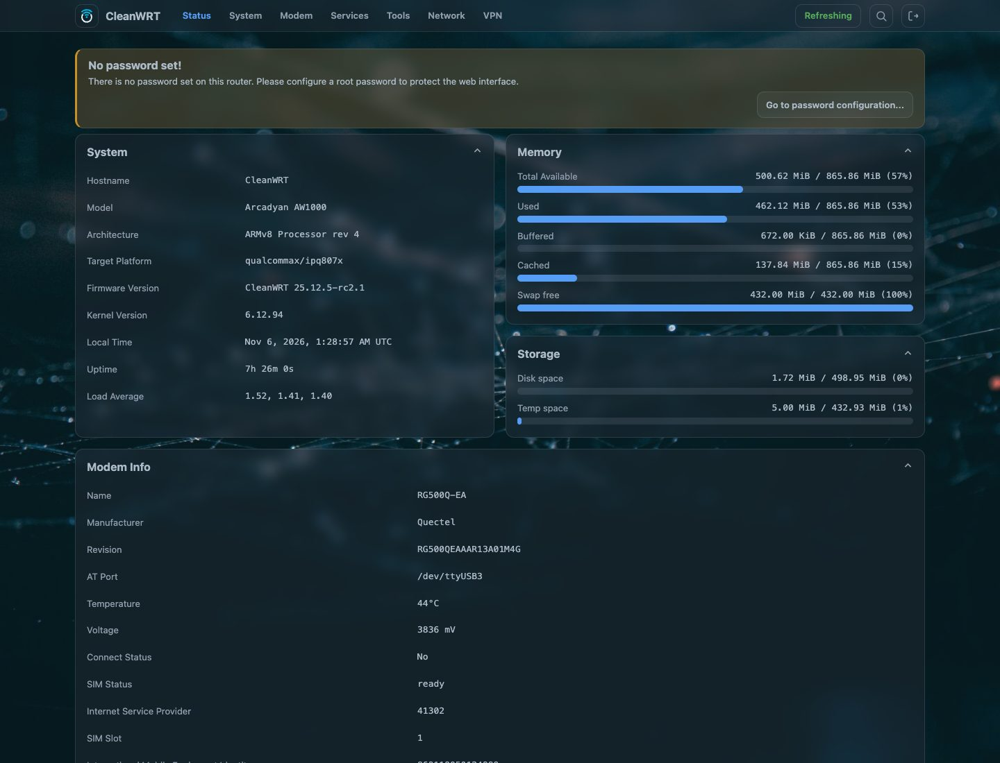
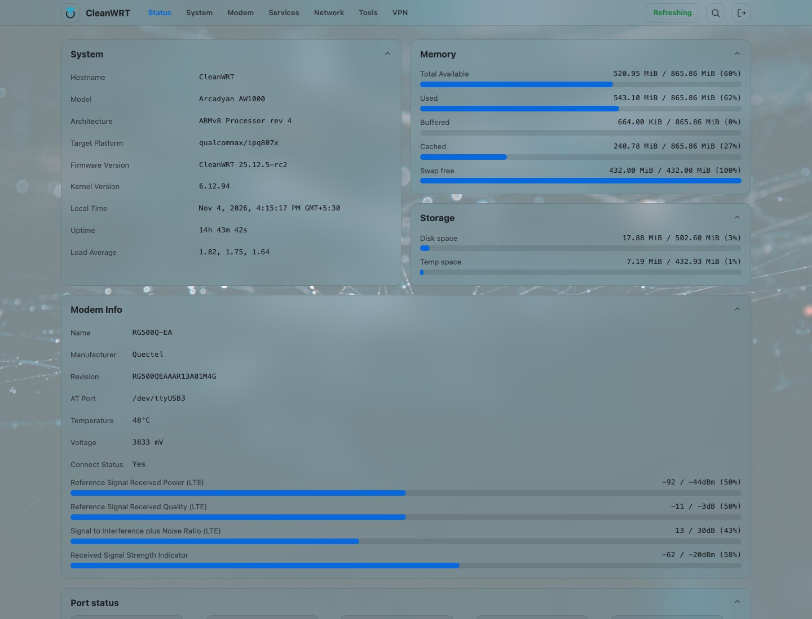
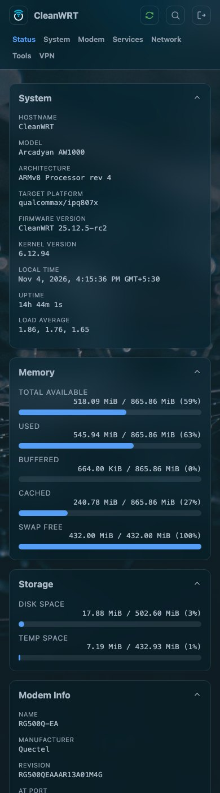
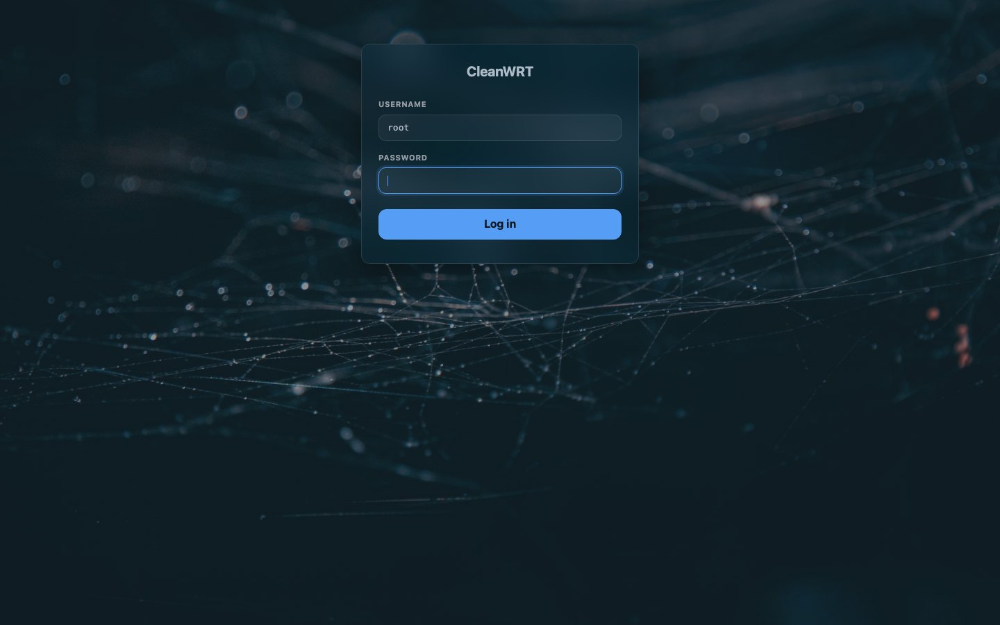
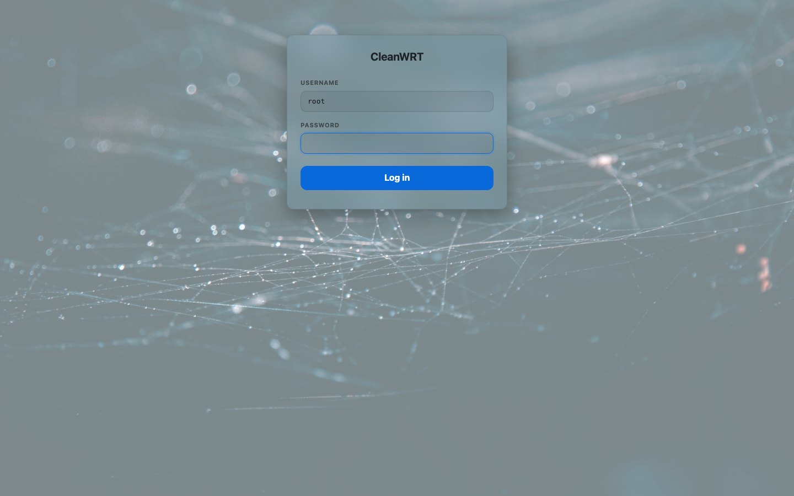
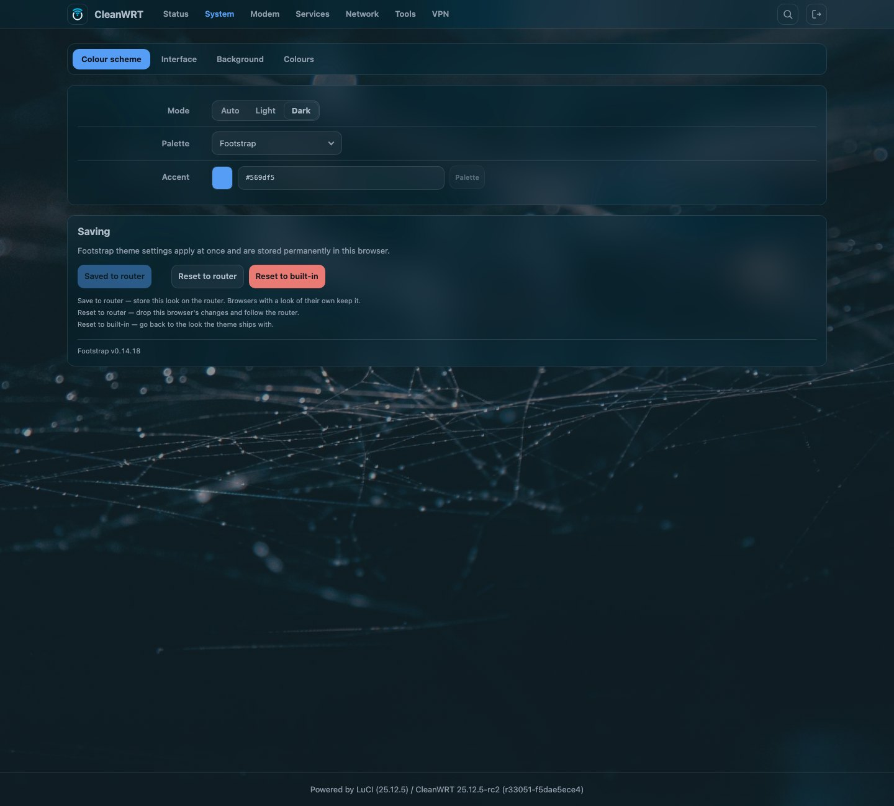

# The Footstrap theme

CleanWRT ships with **Footstrap** as its web interface. It is an ordinary LuCI theme maintained
upstream as
[`luci-theme-footstrap`](https://github.com/VizzleTF/luci-theme-footstrap) (Apache-2.0), pinned to
one commit in `configs/local-packages.pin`
like every other out-of-feed package here. **CleanWRT changes one line of it** -
`patches/packages/luci-theme-footstrap/0001-login-page-carries-the-image-logo.patch` puts the CleanWRT
logo on the login page where the theme otherwise prints the router's hostname - and nothing else: what
you see is the theme as its own author publishes it, selected by
`files/etc/uci-defaults/96-cw-default-theme`
on first boot.

## What it looks like

- **Dark by default**, with light and auto modes, and a choice per browser as well as one saved on
  the router.
- A **top bar or a sidebar** for the menu, and a narrow-screen layout below 768 px.
- Five **palettes** - Footstrap, Bootstrap, 2020, Forum and Hi-Contrast - plus a free **accent
  colour** you can set by hue or by hex.
- **Frosted surfaces**: cards, controls and bars each take their own colour, material
  (flat, acrylic or frosted), opacity and a blur amount, with a corner rounding from 0 to 20 px.
- A **wallpaper** behind the pages: an SVG pattern of your own, or a photo, with the pattern's size,
  strength and ink and the photo's dimming all adjustable. The login page takes the same photo, and
  carries the CleanWRT logo above the username.
- **Density** (normal, compact, large) and a **content width** from 1280 to 3840 px.

## Screenshots

=== "Dark"

    

=== "Light"

    

=== "Phone"

    { width="300" }

The login page, dark and light:

| Dark | Light |
|---|---|
|  |  |

The theme's own settings page:

!!! info "About the screenshots"
    These were taken from a real AW1000 running this firmware. The status page is LuCI's own: the
    theme draws its tables as boxes, and no part of it is patched by this repository.

## The settings page: System → Footstrap

The theme registers one page of its own, **System → Footstrap**, with four tabs: *Colour scheme*,
*Interface*, *Background* and *Colours*.

Changes there apply to the browser you are in immediately. Three buttons decide what happens next:

- **Save to router** writes the look into `/etc/config/footstrap`, so every other browser and
  device that opens the page gets it too. A browser that has chosen its own look keeps that choice.
- **Reset to router** drops this browser's own changes and follows the router again.
- **Reset to built-in** goes back to the defaults the theme itself ships with.

## The look a new router starts with

A fresh install does not start at the theme's own defaults:
`files/etc/uci-defaults/50-cw-footstrap-look`
writes the image's default look into `/etc/config/footstrap` on first boot - dark mode, the top
layout, the Footstrap palette, 12 px rounding, frosted surfaces - together with the two files that
make up its background:

- `files/etc/footstrap/login-bg`, the photo behind the pages and the login card;
- `files/etc/footstrap/pattern.svg`, the pattern the *pattern* wallpaper mode draws.

The two settings that name those files hold their checksums, so the script reads the checksums off
the files actually installed rather than trusting a number written down. It runs once: it marks the
look it applied, and a router whose look has already been saved to the router is left alone - your
choice always outranks the image's.

## Switching themes

Footstrap is selected on the first boot. To change it later:

*System → System → Language and Style → Design*

The stock Bootstrap theme stays installed as the fallback. **Argon** and **Alpha** are in the image as
well, each its own package with its own licence and pin, so the three can be compared on the device.
Alpha is written for an older LuCI layout, so if choosing it leaves pages that do not look right, that
is what you are seeing - nothing else about the firmware changes when you switch.

## Notes for developers

The theme installs its ucode templates under
`/usr/share/ucode/luci/template/themes/footstrap/` (`header.ut`, `footer.ut`, `sysauth.ut` and two
partials), its resources under `/www/luci-static/footstrap/`, its settings view at
`/usr/share/luci/menu.d/luci-theme-footstrap.json` pointing at `footstrap/appearance`, and its own
`/etc/config/footstrap` conffile with a first-boot script of its own. Because that conffile belongs
to the package, this repository ships no copy of it: the image's look is applied by the
`uci-defaults` script above instead.

The two background files live in `/etc/footstrap/`, which the theme's own
`/lib/upgrade/keep.d/luci-theme-footstrap` lists, so a sysupgrade keeps whatever the admin uploaded
there. `/www/luci-static/footstrap/bg` and `.../fonts` are symlinks into that directory.

## Common questions

??? question "Does CleanWRT have a dark mode?"
    Yes, and it is the default. *System → Footstrap → Colour scheme → Mode* offers Auto (follows
    your system), Light and Dark; a browser can also keep its own choice, which **Reset to router**
    gives up.

??? question "Does the theme work on a phone?"
    Yes. The layout collapses below 768 px, and the density and content width are adjustable on the
    settings page.

??? question "How do I switch back to the default OpenWrt theme?"
    Go to *System → System → Language and Style → Design* and pick Bootstrap. Bootstrap stays
    installed in the image precisely so that this is always possible.

??? question "Does CleanWRT patch the theme?"
    One line, for branding: the login page shows the CleanWRT logo instead of the router's hostname.
    Everything else is the upstream package at its pinned commit. The logo is this repository's own
    file (`files/www/luci-static/cw-branding/login-logo.png`), outside the theme's directory, so a
    theme update can neither overwrite it nor collide with the patch. The look a new router starts
    with is added by a first-boot script and two background files, not by a patch.
